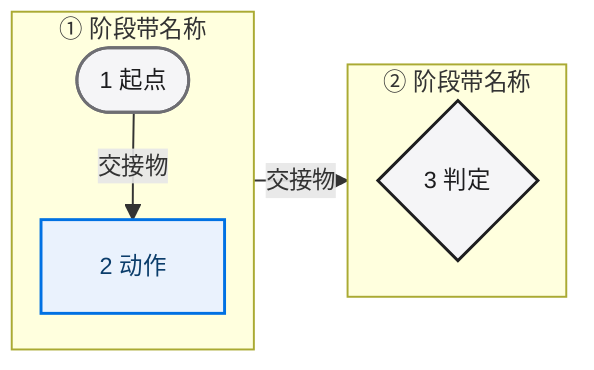
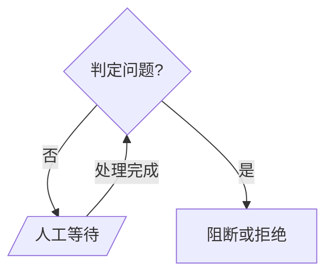

# NoahsArk Markdown 流程图规范

> 文档编号：NoahsArk-FLOWCHART-STYLE-v1.0
>
> 日期：2026-10-26
>
> 适用范围：`docs/**/*.md` 中的 Mermaid 流程图、判定图与状态图
>
> 不适用范围：产品 UI、设计令牌、Apple 原型。本规范只约束文档图示，不是 UI 设计系统。

---

## 0. 结论先行

1. **一图一问**：一张图只回答一个问题；问题写不进一句话，就拆图。
2. **上限 15 个节点**：接近上限时先删无信息节点，再考虑拆图；禁止 25 节点以上的“全景图”。
3. **方向固定**：流水线用 `flowchart LR`，分支与失败边界用 `flowchart TD`，状态迁移用 `stateDiagram-v2`。
4. **形状先于颜色**：胶囊、矩形、菱形、平行四边形、圆柱各自承载一种语义；颜色只是辅助。
5. **边必须带信息**：每条边写动词短语或判定结果，回环边写清“从哪来、回哪去”。
6. **图例与短说明是图的一部分**：图前 1 至 2 句说明问题，图后一行图例；读者不读正文也能看懂。

---

## 1. 为什么拆分旧图

`SOLUTION.md` 原来的第 5 节有两张 Mermaid 图：一张 25 节点以上的 `flowchart TD` 主干图，一张 8 节点的证据边界图。问题不在“画得不够漂亮”，而在信息架构：

| 旧图问题 | 后果 | 本次处理 |
|---|---|---|
| 一张图同时画正常路径、评审回环、自修复回环、验证回环、人工阻塞、停止和 dry-run 判定 | 读者无法判断哪条是主路径 | 拆成图 5-1（只画正常路径）与图 5-2（只画判定与失败边界） |
| 节点超过 25 个，跨层回边多 | 箭头交叉、标签拥挤，GitHub 宽度下文字过小 | 图 5-1 压到 12 节点、11 条边；图 5-2 为 15 节点、17 条边 |
| 节点文字把“阶段名 + 动作 + 证据”混在一行 | 节点变成段落，扫描成本高 | 节点只留阶段号与短名词，细节放 5.2 节表格 |
| 颜色与形状没有稳定映射 | 同一颜色在不同图里含义不同 | 固定五类语义色，并用形状与文字重复表达 |
| 5.5 节的证据边界图与主干图重复 | 两张图讲同一件事，维护时容易漂移 | 删除该图，保留证据资格表，并在 5.1.2 增加 `run_mode` 判定分支 |

**为什么没有加 `stateDiagram-v2`**：文档只定义了终态集合（`PASS`、`FAIL`、`BLOCKED_HUMAN`、`CANCELLED`、`STOPPED`、`INFRA_ERROR`）和 `WAITING_HUMAN` 非终态，没有给出完整的状态迁移表。画状态图就必须补造迁移边，这会违反“不发明业务语义”。因此本次只交付两张流程图；等 5.4 节补出迁移表后再增加状态图。

**一处源文档语义张力**：5.4 把 `BLOCKED_HUMAN` 列为终态，但 5.2 第 7 行与旧图暗示阻塞后可以恢复。本次按 5.4 把 `BLOCKED_HUMAN` 画成终态胶囊，不画回边；恢复动作只写在图例中并指向 5.3，避免让“终态”带出边。该口径需要在方案评审时确认。

---

## 2. 采用的规则与来源

| # | 规则 | 来源 | 落地方式 |
|---|---|---|---|
| 1 | 一张图回答一个问题；按抽象层“缩放”，不要把上下文、容器、组件、代码塞进一张图 | Microsoft Devsquad `diagram-design` | 图 5-1 只讲阶段推进，图 5-2 只讲判定边界 |
| 2 | 图显得拥挤就拆；避免交叉箭头；元素上限约 15 个 | 同上 | 12 / 15 节点；几何校验 0 交叉 |
| 3 | 每个元素必须有名称和职责；没有职责的节点删除 | 同上 | 删除“开始”“结束”装饰节点，用阶段 1 / 阶段 12 胶囊承担 |
| 4 | 每条关系带动词短语；方向约定全图一致；有颜色/形状/线型时必须给图例 | 同上 | 边标签为“需求、方法、冻结、通过、证据、一致”等 |
| 5 | 形状承担语义；颜色不能是唯一区分手段；颜色控制在 4 至 5 种 | 同上 | 五种形状 + 五种语义色 + 文字图例 |
| 6 | 流水线用 `LR`；分支逻辑用 `TD`；生命周期用 `stateDiagram-v2`；角色交互用 `sequenceDiagram` | pm-skills Mermaid Style Guide | 图 5-1 用 `LR`，图 5-2 用 `TD` |
| 7 | 用 `classDef` 统一节点样式；子图标题加引号；换行用 `<br/>`；支持子图之间的边 | Mermaid 官方 Flowchart 语法 | 两张图均使用 `classDef` + `class`；标题全部加引号 |
| 8 | 子图内节点一旦连到子图外，子图自己的 `direction` 会被忽略 | Mermaid 官方 Flowchart 语法“Direction in subgraphs / Limitation” | 图 5-1 改为“子图 → 子图”连线，阶段带内部才能保持 `TB` 堆叠 |
| 9 | 语义色要克制、含义稳定，清晰优先于装饰 | Apple Human Interface Guidelines — Color | 只保留 ink / blue / green / amber / red 五类 |
| 10 | 不能用颜色作为传达信息的唯一视觉手段 | WCAG 2.1 SC 1.4.1 Use of Color | 形状、文字、图例三重表达 |
| 11 | GitHub 使用 `mermaid` 代码块渲染；渲染宽度受正文栏约束 | GitHub Docs — Creating diagrams | 图 5-1 实测约 1078px，图 5-2 约 950px |

来源链接：

- Microsoft Devsquad, `diagram-design/SKILL.md`：<https://github.com/microsoft/devsquad-copilot/blob/main/.github/plugins/devsquad/skills/diagram-design/SKILL.md>
- pm-skills, Mermaid Diagram Style Guide：<https://github.com/product-on-purpose/pm-skills/blob/main/site/src/content/docs/reference/mermaid-style-guide.md>
- Mermaid, Flowchart Syntax：<https://mermaid.js.org/syntax/flowchart.html>
- Mermaid, State Diagram Syntax：<https://mermaid.js.org/syntax/stateDiagram.html>
- Apple, Human Interface Guidelines — Color：<https://developer.apple.com/design/human-interface-guidelines/color>
- W3C, WCAG 2.1 — Use of Color：<https://www.w3.org/WAI/WCAG21/Understanding/use-of-color.html>
- GitHub Docs, Creating diagrams：<https://docs.github.com/en/get-started/writing-on-github/working-with-advanced-formatting/creating-diagrams>

---

## 3. 图示类型选型

| 要表达的内容 | 使用 | 不使用的理由 |
|---|---|---|
| 有序阶段、流水线、泳道 | `flowchart LR` | `TD` 会把长流水线拉成十几屏 |
| 分支、回环、失败边界、判定树 | `flowchart TD` | `LR` 的横向分支在 GitHub 宽度下会被压缩 |
| 命名状态之间的迁移 | `stateDiagram-v2` | 没有迁移表时不要画，避免发明状态 |
| 多个角色/系统来回交互 | `sequenceDiagram` | 流程图无法表达时间顺序与往返 |
| 层级、归因、组成关系 | `flowchart TD` 或 `mindmap` | `LR` 会被误读为流程 |

**方向约定**：同一张图只用一个主方向。回边允许存在，但必须是从下游指回上游的显式边，不能靠调整节点顺序暗示。

---

## 4. 形状约定

| 语义 | Mermaid 写法 | 视觉 | 使用规则 |
|---|---|---|---|
| 开始 / 终态 | `A(["文本"])` | 胶囊 | 只用于流程入口和终态；不用于普通动作 |
| 动作 / 阶段 | `A["文本"]` | 矩形 | 一个节点只放一个阶段或一个动作 |
| 判定 | `A{"文本"}` | 菱形 | 出边必须写判定结果（是/否、通过/不通过） |
| 人工等待 | `A[/"文本"/]` | 平行四边形 | `BLOCKED_HUMAN`、人工确认、重新批准 |
| 证据 / 归档 | `A[("文本")]` | 圆柱 | 证据包、知识回写、归档产物 |
| 阻断 / 拒绝 | 矩形 + `stop` class | 红色矩形 | 只用于“不能继续/不能作为证据”，不用于普通失败 |

禁止用 emoji、外部图片、装饰性图标代替形状或文字。

---

## 5. 颜色约定

颜色是第二信号，不是第一信号。下表只用于文档图，与产品 UI 令牌无关。

| 语义 | 填充 | 描边 | 文字 | 必须搭配 |
|---|---|---|---|---|
| 边界 / 判定（ink） | `#F5F5F7` | `#1D1D1F` 或 `#6E6E73` | `#1D1D1F` | 菱形或胶囊形状 |
| 执行动作（blue） | `#EAF2FD` | `#0071E3` | `#0B3D6B` | 矩形 + 动词开头 |
| 通过 / 完成（green） | `#E7F6EA` | `#2E7D32` | `#14532D` | 胶囊 + “PASS / 完成”文字 |
| 人工等待（amber） | `#FFF3E0` | `#B26A00` | `#6B3E00` | 平行四边形 + `HUMAN` 或“人工”文字 |
| 阻断 / 拒绝（red） | `#FDECEC` | `#C62828` | `#7F1D1D` | 矩形/胶囊 + “拒绝 / FAIL”文字 |

规则：

1. 单图不超过 5 种语义色；同一语义在所有图中使用同一组色值。
2. 不使用红/绿作为唯一对照组；红绿节点必须同时有不同形状或不同文字。
3. 浅色填充 + 深色文字，保证 GitHub 深色主题下节点内部仍有对比度。
4. 图后必须有一行文字图例，说明形状与颜色的含义。

---

## 6. 连线约定

1. **方向**：主路径从左到右或从上到下；回边单独走一侧，不穿过节点。
2. **标签**：格式为“动词 + 对象”或“判定结果 + 后果”，例如“批准并冻结”“不一致：阻断 PASS”。禁止无标签的回边。
3. **判定出边**：每条出边写条件，不写“是/否”之外的含义；条件较长时用 `<br/>` 换行。
4. **回环**：一条回环只表达一个修复动作；不要把“诊断、修复、重跑、重批”塞进同一条边。
5. **禁止交叉**：出现交叉时优先拆图，其次调整分支顺序，最后才考虑加长边。
6. **禁止装饰边**：没有语义的虚线、双向箭头、指向图外的箭头一律删除。

---

## 7. 复杂度预算

| 指标 | 预算 | 当前值 |
|---|---|---|
| 每图节点数 | ≤ 15（硬上限） | 图 5-1：12；图 5-2：15 |
| 每图边数 | ≤ 18 | 图 5-1：11；图 5-2：17 |
| 每图阶段带 / 泳道 | ≤ 6 | 图 5-1：6 |
| 每个判定的回边 | ≤ 1 | 图 5-2：每个判定最多 1 条 |
| 图宽（12 至 13px 字号） | 目标 ≤ 1100px | 图 5-1：约 1078px；图 5-2：约 950px |
| 图例 | 必有 | 两张图均有 |

超预算时的处理顺序：

1. 删除没有独立职责的节点（“开始”“结束”“处理中”）。
2. 合并同一阶段的“动作 + 证据”节点。
3. 把异常分支移到第二张图。
4. 仍超限则按阶段带拆成多图，并在图前写明“本图是第几张，下一张看什么”。

---

## 8. 标准模板

### 8.1 流水线泳道（`flowchart LR`）



**注意**：阶段带内部一旦有节点连到带外，`direction TB` 会失效。要让泳道保持竖向堆叠，必须把跨带连线写成 `P1 --> P2`（子图到子图），而不是 `A2 --> A3`（节点到节点）。这是 Mermaid 的已知限制，不是语法错误。

### 8.2 判定与失败边界（`flowchart TD`）



### 8.3 图例模板

```text
图例：胶囊 = 开始/终态；矩形 = 动作；菱形 = 判定；平行四边形 = 人工等待；圆柱 = 证据/归档。
颜色只作辅助：蓝 = 执行，绿 = 通过，琥珀 = 人工，红 = 阻断；语义同时由形状和文字表达。
```

---

## 9. 反模式

| 反模式 | 症状 | 修复 |
|---|---|---|
| 25 节点以上的全景图 | 一屏放不下，箭头互相穿越 | 按阶段带拆图，每图一问 |
| 节点写成段落 | 节点比边还长，无法扫描 | 节点只留名词；细节进表格 |
| 无标签的回边 | 读者不知道为何回退 | 写“不满足 → 修订后重批” |
| 颜色即状态 | 灰度打印或色觉差异时信息丢失 | 形状 + 文字 + 图例 |
| 混用两种方向 | 同一张图既有 LR 又有 TD 分支 | 拆成流水线图 + 判定图 |
| 用子图模拟泳道但节点跨带连线 | `direction TB` 失效，泳道退化成一行 | 改成子图到子图连线 |
| 重复图 | 两张图讲同一件事 | 保留一张，另一张改为表格 |
| 伪造渲染证据 | 只写“已渲染”但没有产物 | 保留 SVG/PNG 与校验输出 |
| 把 dry-run 画成 PASS 路径 | 违反真实执行边界 | dry-run 只能指向“拒绝作为完成证据” |
| 用状态图替代业务流程图 | 把阶段当状态，语义漂移 | 阶段用 flowchart，状态迁移用 stateDiagram |

---

## 10. 校验流程

每次修改图示后按顺序执行：

1. **语法**：用 Mermaid CLI 渲染，退出码必须为 0。
2. **结构**：统计节点/边数，确认不超过预算。
3. **几何**：检查节点重叠、边穿节点、边与边交叉、标签压节点，结果必须为 0。
4. **语义**：逐条对照正文，确认没有新增/删除阶段、门禁或终态。
5. **宽度**：在 GitHub 正文宽度（约 900px）和 VS Code 预览下检查可读性；超宽时先删字，不要先缩字号。
6. **产物**：SVG 与 PNG 放入 `docs/v2/diagrams/`，`.mmd` 源文件同目录保留。

本次使用的命令：

```powershell
$env:PUPPETEER_EXECUTABLE_PATH = "C:\Program Files\Google\Chrome\Application\chrome.exe"

npx -y @mermaid-js/mermaid-cli@11.4.2 `
  -i docs/v2/diagrams/main-workflow.mmd `
  -o docs/v2/diagrams/main-workflow.svg -b white

npx -y @mermaid-js/mermaid-cli@11.4.2 `
  -i docs/v2/diagrams/decision-boundaries.mmd `
  -o docs/v2/diagrams/decision-boundaries.png -b white -s 2
```

若目标机器没有 Chrome/Edge，可省略 `PUPPETEER_EXECUTABLE_PATH`，让 Puppeteer 下载 Chromium；内网环境应先确认下载权限。

几何校验使用本地 Chrome 读取 SVG 的 `getBoundingClientRect()` 与 `getPointAtLength()`，检查：

- 节点两两重叠面积；
- 边采样点是否落入非端点节点；
- 边与边的线段交点；
- 边标签与节点的重叠。

---

## 11. 已知限制

1. **Mermaid 版本差异**：Mermaid 12 默认使用 `neo` 外观与 ELK 布局，节点更宽；GitHub 与多数编辑器仍使用 11.x 的经典外观。本文以 11.4.2 的几何为准，同时用 12.0.0 做语法兼容校验。
2. **`%%{init}%%` 可能被宿主忽略**：GitHub 对指令的支持随版本变化。若字号指令失效，图会按默认 16px 重新排版并变宽，但节点、边与语义不变。
3. **子图方向限制**：见 8.1 的说明；跨带连线必须走子图到子图。
4. **深色主题**：本规范使用浅色填充 + 深色文字，节点内部对比度稳定；整图背景由宿主决定，不保证与页面底色完全一致。
5. **未提供状态图**：原因见第 1 节；补出状态迁移表后再新增，不复用本次编号。
6. **视觉像素级复核**：本次以渲染产物与几何数据为证据，未做人工像素级目视比对；若需要像素级结论，应在 GitHub/VS Code 实机预览后补充截图。

---

## 12. 变更记录

| 日期 | 变更 |
|---|---|
| 2026-10-26 | 首版：拆分 `SOLUTION.md` 第 5 节图示，新增图 5-1 / 5-2，删除 5.5 重复图，建立本规范 |
