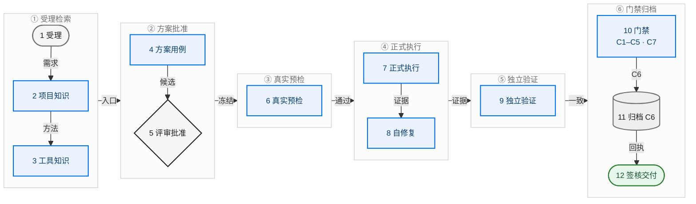
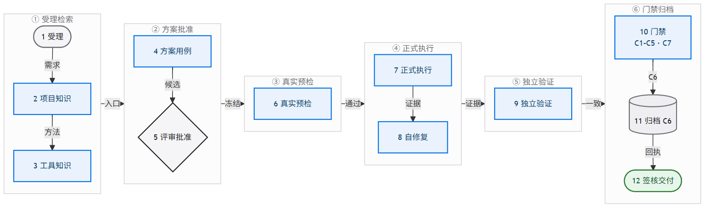
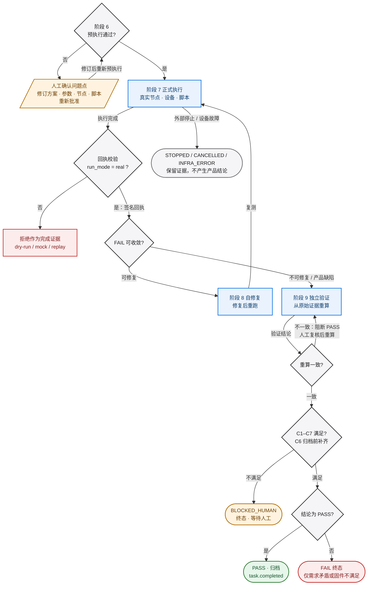
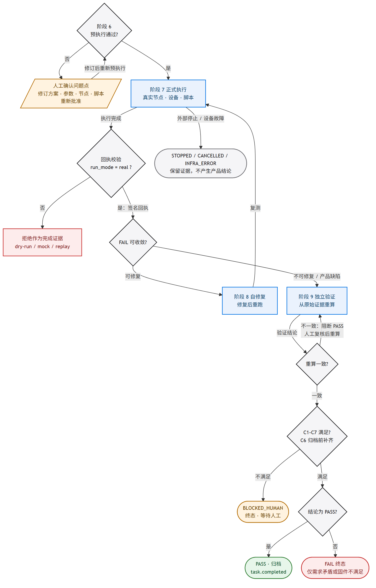

# NoahsArk 平台总体方案

> 文档编号：NoahsArk-SOLUTION-v1.0
>
> 日期：2026-10-26
>
> 状态：**历史方案（2026-10-28 起）**。原“设计定稿候选”不再有效；保留用于追溯产品意图与旧架构叙述。
>
> 当前闸门与执行主线：[NoahsArk 平台交付总计划](../../.omo/plans/noahsark-platform-delivery.md)；契约候选：[docs/contracts/README.md](../contracts/README.md)
>
> 工程基线（历史）：[`IMPLEMENTATION-PLAN.md`](./IMPLEMENTATION-PLAN.md)、[OpenSpec change](../../openspec/changes/ai-test-platform-v2/proposal.md)

## 规范同步说明（2026-10-28，P0-03）

> 本文已按已批准决策做定点修正：PostgreSQL 是唯一正式数据库；判定为五轴并区分执行/设备/证据/判定状态；已启动冻结压测断线后继续、设备保持占用、重连 STOP-first；设备释放、证据完整性和最终判定分离；缺失 `cleanup_receipt` 只阻断释放确认；81 项计划与旧 UI 基线为历史。逐项冲突、仍属历史的内容与验证结果见 [openspec 与 docs/v2 规范同步记录](../delivery/openspec-v2-sync.md)。本文的“【已决】”只表示旧方案内部口径，不再自动等于当前批准；P0-03 不构成实现、测试、部署或验收通过。

---

## 0. 文档定位与约定

### 0.1 文档之间的关系

NoahsArk 的方案材料分为四层，职责不同，不能互相替代。

| 文档 | 角色 | 效力（2026-10-28 同步后） |
|---|---|---|
| [NoahsArk 平台交付总计划](../../.omo/plans/noahsark-platform-delivery.md) | 唯一执行主线，Phase 0–6 | **最高执行依据** |
| `.omo/drafts/` 已审核正文（需求基线、架构、施工验收、测试策略） | 已批准业务与技术边界 | 契约/方案来源 |
| [docs/contracts/README.md](../contracts/README.md) | 字段级候选契约 | 等待评审的契约表达；与 1/2 冲突时以 1/2 为准 |
| `IMPLEMENTATION-PLAN.md` | 旧决策完整版实施计划，包含 D1 至 D13、旧契约、旧 81 个复选框 | **历史参考（2026-10-28 起）** |
| `openspec/changes/ai-test-platform-v2/` | 活跃变更边界，包含 proposal、design、tasks 与 9 个能力增量 | 活跃变更；旧 SQLite/单一终态/81 任务已加同步修正 |
| 本文 `SOLUTION.md` | 统一叙述产品愿景、架构、主流程、模块、路线图与需求追溯 | **历史参考（2026-10-28 起）** |
| `laodengAi/csjh/2026-10-26/`、`laodengAi/knowledge/` | 产品意图、知识库审计、验证方法论与术语 | 输入材料，不是契约 |

发生冲突时，按以下顺序裁决：总计划与已批准 `.omo/drafts` 正文优先，`docs/contracts/` 其次，活跃 OpenSpec 变更再次，本文与旧 `IMPLEMENTATION-PLAN.md` 只作历史参考，`laodengAi` 方案作为产品意图参考。本文不修改任何既有契约，只保留旧方案叙述；凡与总计划冲突处，以总计划与 [规范同步记录](../delivery/openspec-v2-sync.md) 为准。

### 0.2 状态标记

全文使用四种标记，避免把设想写成事实。

| 标记 | 含义 |
|---|---|
| 【已决】 | 已由实施计划、OpenSpec 或用户确认，可以直接作为设计与实现依据 |
| 【待定】 | 需要用户决策、后续设计或真实环境验证，当前不能写成承诺 |
| 【外部依赖】 | 依赖仓库权限、设备窗口、Webhook 目标、模型配额等外部条件 |
| 【缺口】 | 已知材料或文档存在缺失、计数不一致或尚未建立的内容 |

### 0.3 需求覆盖

本文覆盖 11 项平台需求。逐项映射见第 12 节。阅读顺序建议为：第 1 至 3 节理解定位，第 4 至 5 节理解架构与流程，第 6 至 9 节理解模块与治理，第 10 至 12 节理解落地与验收。

---

## 1. 执行摘要

NoahsArk 不是测试执行器（test runner）。它是一个会思考、会动手、会积累的 AI 资深测试工程师平台。

传统测试平台回答的问题是“把这个脚本跑起来”。NoahsArk 先回答“这个需求应该怎么测”，再回答“用哪套工具、哪台设备、哪种证据来证明”，最后才进入执行。它把项目知识、工具知识、历史任务、失败根因和脚本修复连成一条可追溯的工作链。

平台具备三种核心能力。

1. **会想**：任务进入后，先检索项目知识库，回答“这个项目怎么测”；再检索工具知识库 lstest，回答“用什么框架、什么 profile、什么执行入口”；然后生成带需求追溯的方案、用例和可证伪 oracle。
2. **会做**：在真实节点、真实设备、真实串口和声卡上预执行与正式执行；执行中自行诊断和修复测试逻辑、环境与脚本问题；修复后重新验证，不把测试自身的问题写成产品 FAIL。
3. **会记**：任务结束后写入任务 playbook、失败案例、根因和脚本修复；知识以 candidate 身份进入，经复核后才晋升；下一次相似任务能直接复用上一次的方法。

平台与普通测试平台的关键差别有五点。

- **知识优先，而不是提示词优先**：方案先由检索到的项目方法和工具契约支撑，再由模型补全。
- **oracle 必须可证伪**：预期结果绑定需求、证据来源和分母规则，不能由“脚本说 PASS”循环自证。
- **完成必须有真实执行凭证**：真实节点签名回执、租约、端点身份、产物清单哈希，缺一不可；dry-run、模拟、录制、回放不能作为完成证据。
- **完成是门禁对象，不是状态字符串**：C1 至 C7 逐项有证据，终态写入受数据库触发器和看门狗约束。
- **知识回写是任务的一部分**：没有 playbook 或明确的“无可复用知识”理由，任务不能归档。

【已决】平台成功的定义是：Phase 8 的全部门禁在真实设备上通过，并且第二个此前未见过的任务能够检索并复用第一个任务的 playbook，不需要人重新解释测试方法。该定义来自实施计划第 1 节。

【已决】当前阶段只做方案与 UI 设计。方案和 UI 设计获批之前，不写产品代码。

---

## 2. 产品愿景与角色宪章

### 2.1 产品愿景

把“测试工程师”的能力变成平台能力：给一个任务，平台自己检索方法、调度节点设备、组织执行、解决问题、完成验证，并把过程中的经验沉淀为下一次任务的起点。项目越多，平台越懂这个项目；任务越多，平台越懂怎么测。

NoahsArk 的品牌意象是“方舟”：把需求、设备、证据和知识装载起来，穿过不确定的测试过程，最终交付可追溯的结果。产品名与 logo 概念来自实施计划开头的产品定义。

### 2.2 角色宪章：12 条原则

以下 12 条不是宣传语，而是平台必须通过机制落实的行为约束。原则文本对应实施计划第 1.1 节，落地机制对应 OpenSpec `agent-openspec-config`、`completion-gate`、`knowledge-retrieval` 等能力。

| # | 原则 | 平台必须表现出的行为 | 落地机制 |
|---|---|---|---|
| 1 | 先澄清再执行 | 需求范围、验收标准、样本量、环境或 oracle 不明确时，先提问并记录答案；关键字段缺失时进入 `BLOCKED_HUMAN` | 需求摄取、开放问题清单、人工确认门 |
| 2 | 基于风险的策略 | 按项目与设备风险决定测试深度、场景和样本量，不套统一清单 | A/B 风险分级、覆盖矩阵、风险评审 |
| 3 | 知识优先顺序 | 先检索项目知识库回答“怎么测”，再检索工具知识库 lstest 回答“怎么构建与执行”，最后设计运行 | 检索包、引用、`no_history` 显式返回 |
| 4 | 可证伪的 oracle | 预期结果可独立检查，绑定需求与证据；禁止循环断言，禁止“脚本说 PASS 就是 PASS” | 类型化 oracle、独立重算、证据要求注册表 |
| 5 | 建立在 lstest 之上 | 使用 lstest 的框架、profile 和工具契约；不分叉、不复制 lstest；脚本是手段不是目的 | 工具知识库、版本锁、profile 编译 |
| 6 | 真实执行 | 真实节点、设备、串口、音频端点与脚本；dry-run、mock、replay 只能做准备，不能作为完成证据 | 执行回执、`run_mode` 校验、C2 门禁 |
| 7 | 像工程师一样诊断 | 区分产品、测试逻辑、环境、基础设施和需求问题；raw FAIL 必须先收敛，再成为最终 FAIL | 14 步根因树、失败归类、复测链 |
| 8 | 拒绝假 PASS | 证据不足时输出 `BLOCKED`、`WARN` 或 `TIMING_AMBIGUOUS`，不为了迎合请求者而给出无证据 PASS | 证据充分性门禁、独立重算、完成契约 |
| 9 | 教会平台 | 回写 playbook、失败案例、根因、脚本修复、项目与工具知识；去重、版本化、标注适用边界 | 知识库生命周期、整编任务、候选晋升 |
| 10 | 解释决策 | 每份方案、用例、oracle 和结论都引用需求、方法和证据，不出现无解释结论 | 追溯矩阵、引用格式、评审模板 |
| 11 | 在正确时机升级给人 | 模糊、高风险、不可逆操作必须人工批准；支持接管和显式停止 | 人工审批门、接管租约、停止控制 |
| 12 | 可度量地改进 | 跟踪假 PASS 逃逸、评审发现、知识复用率、工具修复率和返工率，用指标改进下一次任务 | 角色记分卡、方案质量指标、E2E 证据 |

### 2.3 角色记分卡

【已决】P4-13 评估以下指标：需求澄清完整度、需求到用例的追溯率、oracle 独立性、假 PASS 逃逸次数、根因分类准确率、知识复用率、脚本与工具修复率、评审阻断项解决率、真实执行占比。指标不是装饰性报表，而是下一轮方案改进的输入。

### 2.4 明确不是什么

- 不是任务执行器：只负责跑脚本的平台不满足第 1 节的成功定义。
- 不是聊天界面：对话是交互方式，不是交付物；交付物是方案、证据、结论和知识。
- 不是提示词生成器：没有检索、类型化产物、确定性保证和对抗评审的方案不进入执行。
- 不是只信 runner 的仪表盘：runner PASS 必须被独立重算和证据门禁复核。
- 不是自动批准模型猜测的知识库：候选知识必须经过复核才能成为 approved。

---

## 3. 范围与非目标

### 3.1 范围内

11 项需求按四种能力归类。

| 能力 | 需求 | 主要模块 |
|---|---|---|
| 会想 | 相似任务检索与 playbook 复用；方案、用例、oracle 的质量保证 | 知识库、检索、规划、评审、保证 |
| 会做 | 运行时模型切换；真实执行；自修复；人工接管 | 模型、执行、节点设备、接管 |
| 会记 | 失败、日志、根因、脚本修复、项目与工具知识写回 | 知识库、失败挖掘、归档 |
| 可治理 | 版本锁与升级兼容；主动推送；完整 UI；OpenSpec 与 Agent 治理 | 工具链、事件推送、UI、Agent 配置 |

逐项需求与任务、证据的对应关系见第 12 节。

### 3.2 非目标

以下内容不在 v2 范围内，来源为实施计划第 2 节。

1. 不复用 legacy 平台的 UI、路由、模板、执行适配器、旧运行时、数据库结构或测试夹具。NoahsArk 是全新代码库；Flask + Jinja2 只是新项目的技术选择，不是对 legacy 平台的继承。
2. 不建立第二套工作流状态机。NoahsArk 自身只有一套新工作流作为状态真相。
3. 不允许模型或 Agent 直接写运行、租约、终态、已批准知识或发布状态。
4. 不自动把候选知识晋升为 approved，不以圆桌多数票作为验收门。
5. 不跨机器复制凭据，provider secret 不进入节点、知识库、日志或 UI。
6. 不接受“用 mock 通过”。mock、录制、回放只用于单元测试和预检，不能作为完成证据。
7. 不接受 dry-run、mock、replay 作为完成证据。执行层从第一条真实运行开始实现，不复用 legacy 平台的假执行路径。
8. 不做多租户 SaaS、计费或面向公网的认证体系重构。

### 3.3 本阶段边界

- 【已决】当前只交付方案与 UI 设计，不交付产品代码。
- 【已决】UI 设计由配套文档 `UI-DESIGN.md` 与线框负责，本文只描述信息架构与页面职责，不复制完整视觉规格。
- 【待定】C8“测试之测试”只有占位，验收语义尚未定义，详见 11.5 节。
- 【历史】平台自我迭代、自动修改平台自身代码、热升级平台服务，不在旧 81 个任务中；`laodengAi` 方案把它列为设置模块能力。81 项计数已取代，是否纳入后续版本仍由总计划阶段决策，不在 P0-03 发明任务数。
- 【外部依赖】真实设备窗口、Webhook 目标、模型配额、仓库推送权限不在方案阶段解决。

### 3.4 与 legacy 平台的边界

【已决】NoahsArk 不复用 legacy 平台的 UI 和执行层。legacy 平台只能作为问题清单和反面参考，不能作为底座。

| 领域 | 允许参考 | 明确禁止 |
|---|---|---|
| 执行层 | 失败模式、门禁思想、设备测试经验 | 复用 旧运行时、mock/dry-run 执行路径、旧 runner、旧数据库状态、旧测试夹具 |
| UI | 信息密度、操作习惯的问题清单 | 复用旧模板、旧路由、旧样式、旧页面结构；旧 `UI-DESIGN.md` 已转为历史参考，NoahsArk UI 以 Phase 1 冻结的 Apple 风格基线（当前候选 `UI-DESIGN-APPLE.md`）为准 |
| 数据 | 历史问题的分类方式 | 复用旧表结构、旧状态字段、旧“已通过”结论 |
| 知识 | 已验证的方法论、术语、失败原因 | 把旧平台的假执行结果当作证据或 playbook |

执行层的唯一可信证明是：真实节点、真实设备、真实脚本、真实证据、节点签名回执、独立复算。任一缺失都不能写成 PASS。

---

## 4. 总体架构

### 4.1 分层结构

```text
+------------------------------------------------------------------+
| 交互层   NoahsArk Console                                        |
| Flask + Jinja2 + ES Modules + SSE + xterm                        |
| 任务 / 任务详情 / 知识 / 节点设备 / 模型 / 版本 / 推送 / 接管 / 设置 |
+-------------------------------+----------------------------------+
                                | HTTP API, SSE, WebSocket
+-------------------------------v----------------------------------+
| 编排层   opencode CLI + OMO                                      |
| Lead Agent / 子 Agent 后台派发 / 会话持久化 / 并发与权限配置       |
+-------------------------------+----------------------------------+
                                | 命令门面，类型化命令，幂等键
+-------------------------------v----------------------------------+
| 执行层   Node Agent + opencode session + lstest runner            |
| 预执行 / 正式执行 / 自修复 / 证据采集 / 独立验证                   |
+-------------------------------+----------------------------------+
                                | 串口, 声卡, 电源, 网络, 云端
+-------------------------------v----------------------------------+
| 设备层   节点 / 被测设备 / 端点身份 / 设备租约                     |
+------------------------------------------------------------------+
| 能力层   项目知识库 / 工具知识库 lstest / 讨论插件                 |
+------------------------------------------------------------------+
| 事实层   PostgreSQL（唯一正式数据库）：工作流 / 事件 / 证据 / 知识 / 门禁 / 交付 |
+------------------------------------------------------------------+
| 治理层   OpenSpec / Agent Registry / Toolchain Lock / RBAC / 审计  |
+------------------------------------------------------------------+
```

### 4.2 两个平面，一个事实源

【已决】架构采用两个平面，不允许第三个状态真相。来源为实施计划 D3 与 OpenSpec design。

| 平面 | 组成 | 能做什么 | 不能做什么 |
|---|---|---|---|
| 智能平面 | Lead Agent、planner、case writer、script implementer、reviewer、圆桌 | 产出类型化候选工件与 `AgentEffect`；提出方案、用例、脚本、评审意见 | 不能直接写运行、门禁、租约、终态、已批准知识或发布状态 |
| 确定平面 | 工作流、权限、租约、派发、lstest、证据、验证、完成门禁、归档 | 拥有全部不可逆事实；执行命令、校验证据、写终态 | 不替 Agent 思考方案；不绕过门禁 |

Agent 可以提议，只有命令门面可以改变不可逆事实。任何“模型直接改数据库”的路径都视为架构违规。

### 4.3 交互层

【已决】交互层是全新的 NoahsArk 前端，采用 Flask + Jinja2 + 原生 ES Modules + SSE，不引入 Node 构建链；不复用 legacy 平台的 `server.py`、模板、静态资源或页面结构。视觉语言按 NoahsArk 品牌、方舟 logo 与新设计令牌重建。`xterm` 本地打包，支持内网离线使用。

- 新路由放在 NoahsArk 的 `app/api/`，由薄蓝图注册；不继承 legacy 平台的 `legacy-platform/aitest/platform/api.py`。
- NoahsArk API 统一位于 `/api/noahsark/v2/**`，页面位于 `/noahsark/**`。
- 前端共享 API 客户端负责 CSRF、401/403、事件游标与降级轮询。
- 页面只读投影命令 API，不直接拼装业务状态。
- UI 的完整页面规格、组件、断点、可访问性要求由 `UI-DESIGN.md` 负责，本文第 8 节只给信息架构。

### 4.4 编排层

【已决】编排层使用 opencode CLI 与 OMO。一个任务对应一个 Lead Agent 会话；Lead Agent 负责意图分类、检索、拆解、派发、汇总与报告。子 Agent 以后台会话执行，不阻塞 Lead Agent。

- 子 Agent 类型包括测试执行、代码搜索、资料查询、疑难诊断、计划审查等，按依赖 DAG 调度，无依赖并行。
- 并发上限、单模型并发、子 Agent 超时、重试次数、自动续跑由平台配置文件约束。
- 会话消息、工具调用、产物和证据持久化，支持列表、读取、搜索和回放。
- 权限矩阵复用 OMO 的工具限制：执行者可写，探索者与审查者只读，防止越权。
- 服务重启后未完成任务标记为中断，可显式恢复，不假装仍在运行。

### 4.5 执行层

【已决】执行层由 **全新实现** 的节点 Agent、opencode 会话和 lstest runner 组成。执行入口优先使用 lstest 的统一入口与 profile 契约，不为单个用例写一次性脚本。

【已决】执行层不复用 legacy 平台的 旧运行时、mock/dry-run 适配器、旧 runner、旧状态表或旧测试夹具。legacy 平台的执行只能作为反例阅读，不能作为 NoahsArk 的运行底座。

运行模式必须显式标注：`real`、`dry_run`、`simulated`、`recorded`、`replay`。只有 `real` 可以作为完成证据。真实运行必须带节点执行回执，回执至少包含节点 ID、租约 ID、串口与音频端点身份、runner 退出状态、产物清单哈希，并由节点密钥签名。

### 4.6 节点与设备层

节点是一台可执行测试的机器，记录 IP、SSH 或 Agent 通道、凭据引用、操作系统、已安装工具与版本、心跳状态。设备是挂在节点下的被测对象，记录机型、固件、串口角色与端口、声卡端点、适配项目、能力标签和租约持有者。

设备描述支持文本批量解析，例如把“COM3 空调 项目 A；COM5 音箱 项目 B”解析为结构化记录，减少手工录入。串口和音频端点必须使用稳定身份，不能只依赖会变化的 COM 编号。

同一串口或同一设备在任一时刻只能被一个任务占用。租约是确定平面的对象，Agent 不能自行抢占。

【规范同步 2026-10-28】通信离线不等于设备空闲，也不等于设备可回收。已启动的冻结压测在通信中断或心跳过期后继续离线执行；Linux 标记“通信离线”，但设备保持占用，不新派、不重播、不重复采样、不重新分配设备。重连后先处理待 STOP，再补传、去重、对账；旧 epoch 不得改变当前运行。只有完成本地停止、安全清理和占用对账后，才可确认设备释放；缺 `cleanup_receipt` 只阻断“设备释放确认”，不自动把整条证据链判为不完整。

### 4.7 知识与能力层

平台有两类知识库，职责不同。

- **项目知识库**：回答“这个项目怎么测”。包含测试方法论、统计口径、指标定义、词表、场景、项目特性、历史 playbook、失败案例和项目事实。整体可用方法与项目特性必须分开，具体数值、词表、设备、项目名不能泛化为通用默认值。
- **工具知识库 lstest**：回答“用什么工具、怎么构建、怎么执行”。以 lstest 为核心框架，配合 trails 的工程规范、test-plan-architect 的方案构建能力，以及通用设备、音频、报告工具。工具条目必须登记能力、入口、输入输出、副作用、风险等级、适用项目和来源版本。

检索结果作为“不可信证据”注入 Agent 上下文，带引用、适用边界、差异、警告和反例。检索不能覆盖平台硬约束。

讨论插件是能力层的一个可调用工具，不是独立 Web 应用。它复用圆桌角色、议程、模型路由和会议记忆，返回共识、分歧、风险与行动项。

### 4.8 数据与持久层

【规范同步 2026-10-28】**PostgreSQL 是唯一正式数据库。** 原文“数据层使用 SQLite WAL，设置 `busy_timeout=5000` 与 `foreign_keys=ON`；PostgreSQL 是后续选项，不是 v2 依赖”已取代。新 schema 通过幂等迁移创建，迁移前备份，支持回滚；生产事实、租约、事件、证据索引、门禁和交付记录都写入 PostgreSQL。SQLite 仅作为历史参考或只读分析副本出现，不作为正式数据库，也不作为契约结构来源。

核心数据分为六组。

| 组 | 代表表 | 用途 |
|---|---|---|
| 事件 | `platform_events` | 追加式事件真相，供 UI、推送、CLI、审计消费 |
| 设置与模型 | `platform_settings`、`model_bindings`、`model_switch_audit`、`task_model_overrides` | 全局、Agent、任务级模型策略与切换审计 |
| 推送 | `push_subscriptions`、`push_deliveries`、`push_dead_letters` | 订阅、投递账本、死信 |
| 知识 | `kb_entries`、`kb_revisions`、`kb_links`、`kb_feedback`、`kb_fts`、`task_playbooks`、`task_retrievals` | 知识条目、修订、关联、反馈、全文索引、playbook、检索包 |
| 会话与接管 | `executor_sessions`、`takeover_sessions`、`takeover_events` | 原生 CLI 会话、接管租约与审计 |
| 门禁与回执 | `toolchain_lock_runs`、`toolchain_smoke_runs`、`completion_reports`、`completion_gate_evidence`、`executor_receipts` | 版本锁、冒烟、完成报告、门禁证据、执行回执 |

### 4.9 事件与推送层

【已决】所有有意义的状态变化追加到 `platform_events`，事件带单调 `seq`、唯一 `idempotency_key`、类型、严重度、任务 ID、发生时间、载荷和脱敏元数据。推送、UI SSE、CLI watch、检索指标和审计都消费同一份事件日志。

投递语义为至少一次，消费端按事件 ID 去重。推送失败不改变任务状态。渠道包括 SSE、终端、文件和 Webhook。Webhook 使用带时间戳的 HMAC-SHA256 与 URL 允许列表。

`task.completed` 每个任务只发一次，且必须在 C1 至 C7 与归档完成之后。失败、阻塞、停止分别使用 `task.failed`、`task.blocked`、`task.stopped`，不能冒充完成。

### 4.10 治理与安全层

治理层由 OpenSpec、Agent Registry、Toolchain Lock、功能开关、RBAC 与审计组成。安全基线包括统一脱敏、Webhook SSRF 允许列表、路径守卫、知识摄取秘密扫描、接管审计、受保护路径写入评审回执。详见 7.10 节与第 9 节。

### 4.11 部署形态

【规范同步 2026-10-28】NoahsArk 是全新 Flask 服务加 **PostgreSQL**，多个节点 Agent 通过内网连接。原文“单进程 Flask 服务加 SQLite”中的 SQLite 已取代；PostgreSQL 是唯一正式数据库。平台不引入独立 SPA 服务、Node 构建服务或第二套消息中间件。该形态适合内网、单团队、可审计的测试场景；多租户与大规模横向扩展不在 V0.0.1 范围。部署进程数、主备与备份拓扑由总计划 Phase 2/3 冻结，本文不预设。

【已决】NoahsArk 的代码、数据库、模板、路由和执行适配器均从 NoahsArk 仓库开始，不继承 legacy 平台目录结构，也不依赖 legacy 平台进程或数据库。

---

## 5. 核心工作流

### 5.1 主干流程

平台的主干流程如下。顺序不能颠倒：项目知识决定“怎么测”，工具知识决定“怎么构建与执行”，方案评审通过后才允许真实预执行。

原来的单张流程图把主干、回环、人工等待、停止和 dry-run 判定画在同一张图里，节点超过 25 个，读者无法分清“正常路径”和“异常边界”。本节按“一图一问”拆成两张图：图 5-1 只画正常路径，图 5-2 只画判定与失败边界。统一图示规范见 [`FLOWCHART-STYLE.md`](./FLOWCHART-STYLE.md)。

#### 5.1.1 图 5-1：12 个阶段与 6 个阶段带

一次任务按 ① 至 ⑥ 的顺序穿过六个阶段带：① 受理与检索（Intake + Retrieve）、② 方案与批准（Plan + Approve）、③ 真实预执行（Real Preflight）、④ 正式执行（Real Run）、⑤ 独立验证（Verify）、⑥ 门禁与归档（Gate + Archive）。每个节点对应 5.2 节表格中的一个可验收阶段，箭头上的短词表示阶段之间的交接物；本图只画正常路径，不画回环。





> 图 5-1 的渲染源：[main-workflow.mmd](./diagrams/main-workflow.mmd) · [SVG](./diagrams/main-workflow.svg)。如果 Markdown 查看器不渲染 Mermaid，直接看上方 PNG。

**图例**：胶囊 = 开始/终态；矩形 = 动作；菱形 = 判定；圆柱 = 证据或归档；浅灰分组框 = 阶段带。颜色只作辅助（蓝 = 执行动作，绿 = 通过或完成，灰 = 边界与判定），状态含义由形状和文字承担，不依赖颜色。

#### 5.1.2 图 5-2：判定与失败边界

本图只回答一个问题：在真实预执行、正式执行、独立验证和完成门禁之间，哪些判定会让流程回到上游、进入人工等待、被停止，或被拒绝作为完成证据。每条回环边都标出触发条件与返回点。





> 图 5-2 的渲染源：[decision-boundaries.mmd](./diagrams/decision-boundaries.mmd) · [SVG](./diagrams/decision-boundaries.svg)。如果 Markdown 查看器不渲染 Mermaid，直接看上方 PNG。

**图例**：沿用图 5-1 的形状与配色。琥珀色平行四边形 = 人工等待，H1 是预执行失败后的人工确认、修订与重新批准；琥珀色胶囊 = `BLOCKED_HUMAN` 终态，人工处理完成后按 5.3 重新发起执行，本图不画回边；红色 = 阻断或拒绝。`dry-run`、`mock`、`replay` 只能走到“拒绝作为完成证据”，不能走到 PASS；`FAIL` 只在需求矛盾或固件真实不满足时成立。

#### 5.1.3 文本备用图（Mermaid 不可渲染时阅读）

对应图 5-1。

```text
1  任务受理
      |
      v
2  项目知识库检索：这个项目怎么测
      |
      v
3  工具知识库 lstest：用什么构建、怎么执行
      |
      v
4  方案 / 用例 / oracle 生成
      |
      v
5  评审与人工批准（方案冻结）
      |
      v
6  真实预执行（脚本可执行性、环境门禁）
      |
      +---- 不通过 ----> 人工确认问题点 -> 修方案/参数/节点/脚本 -> 回到 5
      |
      v
7  正式执行（真实节点、设备、脚本、样本量）
      |
      v
8  自修复与 FAIL 收敛（只在可修复范围内）
      |
      v
9  独立验证（从原始证据重算结论）
      |
      v
10 完成门禁评估（C1 至 C7，C6 待回写证据）
      |
      v
11 知识回写与归档（补齐 C6：playbook、失败案例、根因、脚本修复）
      |
      v
12 完成签核、交付与主动推送（哈希报告定稿、交付清单、task.completed）
```

### 5.2 阶段说明

| 阶段 | 主要动作 | 产出与证据 | 失败与回退 |
|---|---|---|---|
| 1 任务受理 | 登记需求、资料、项目、设备、风险等级和来源清单；识别缺失字段与开放问题 | 任务 ID、来源清单、需求哈希、开放问题、风险分级 | 关键字段缺失进入 `BLOCKED_HUMAN`，不猜测 |
| 2 项目知识库检索 | 用需求、设备类别、标签检索方法、历史 playbook、失败案例、项目事实 | 版本化检索包，含命中理由、适用边界、差异、警告、引用；无命中显式 `no_history` | 检索为空不阻断，但方案必须说明缺史依据 |
| 3 工具知识库检索 | 检索 lstest 入口、profile、validation pool、设备与音频工具、工程规范 | 工具选型、入口、副作用、风险等级、版本 pin | 工具不匹配或版本漂移时回到方案或升级门禁 |
| 4 方案、用例、oracle | 需求原子化、功能点建模、验证池匹配、覆盖矩阵、类型化用例与 oracle | `test_plan.v2`、用例集、oracle、证据窗口、追溯矩阵 | 多义变体标 `AMBIGUOUS`，未定义维度标 `TODO` 或 `BLOCKED` |
| 5 评审与批准 | 对抗式多模型评审、确定性保证、人工批准、方案冻结 | 评审发现与解决回执、保证报告、批准人/时间、方案哈希 | 阻断项未解决不得批准；修改后生成新版本并失效旧执行 |
| 6 真实预执行 | 在真实设备上验证脚本可执行、环境就绪、串口/声卡/租约可用；样本量按项目配置，计划默认 10 次量级 | 预执行日志、门禁结果、环境快照；不作为完成证据 | 不通过必须人工确认问题点，修改后重新批准 |
| 7 正式执行 | 按批准方案在真实节点/设备执行；持续采集串口、音频、协议、工具日志与状态 | 原始证据、执行回执、产物清单、事件流 | 启动前离线/心跳过期→阻断，不占用；**已启动后通信中断或心跳过期→冻结压测继续离线执行，设备保持占用，不重派/不重播/不重复采样**；重连先处理 STOP；停止保留证据 |
| 8 自修复与收敛 | 诊断异常，区分测试逻辑、环境、设备、固件、需求、基础设施；修复后重跑 | 修复 diff、复测记录、收敛结论、根因候选 | 只有需求矛盾或固件真实不满足才保留最终 FAIL |
| 9 独立验证 | 从原始产物和固定 oracle 重算机器结论，与 runner 结论比对；应用人工与业务策略 | 独立结论、分歧记录、证据图 | 分歧阻断 PASS；人工覆盖后机器结论保持不可变 |
| 10 完成门禁评估 | 评估 C1 至 C5 与 C7，列出 C6 回写义务，生成门禁草案；终态写入仍受触发器保护 | 门禁草案、C1 至 C5 与 C7 证据、C6 待办 | 任一必要门禁不满足则不得写终态 |
| 11 知识回写与归档 | 写 playbook、失败案例、根因、脚本修复；无复用价值时记录理由与操作者；补齐 C6 证据 | `playbook_id`、知识候选 ID、C6 证据、归档回执 | 回写失败可断点续跑；不得跳过归档直接完成 |
| 12 完成签核、交付与推送 | 用 C6 证据签核哈希报告，写终态；生成交付清单与复现清单；推送结果到 UI、终端、文件、Webhook | 最终完成报告、交付清单、复现哈希、`task.completed` 事件 | 推送失败只发警告，不改变任务状态 |

### 5.3 流程硬规则

【已决】以下规则写入平台硬约束，不由 Agent 自行判断是否遵守。

1. **预执行是硬门槛**：未通过预执行，不允许进入正式执行。预执行样本量是项目配置，计划默认 10 次量级；`laodengAi` 方案中的 10 次或 20 次作为可配置范围，不写成所有项目的固定值。
2. **不通过必须人工确认**：预执行不通过不是终点。任务触发者必须确认问题点、修改方案、参数、节点或脚本，然后重新批准。
3. **执行中可干预**：允许查看进度、追加信息、接管、停止和变更任务形态；所有干预留审计。
4. **结果必须可追溯**：每个结果都能回溯到任务输入、执行会话、证据文件、节点设备、脚本版本、模型绑定和工具链锁。
5. **禁止绕过**：不得用 `--skip-pretest`、缩短观察窗口、过滤额外识别、修改结果 CSV 等方式制造通过。
6. **dry-run 不是证据**：dry-run、mock、replay 只能用于准备、调试和单元测试。
7. **资源独占**：同一串口、同一设备、同一音频端点不能被并发任务同时占用。
8. **最终 FAIL 收敛**：只有需求矛盾、需求不可验证或固件真实不满足需求，才能保留最终 FAIL。
9. **离线续跑**：通信中断或心跳过期不得停止已启动的冻结压测，也不得回收设备；设备继续被原任务占用，重连后先处理待 STOP，再补传、去重和对账。
10. **STOP-first 重连**：任何重连都必须先清空/处理待 STOP，再恢复上传与对账；旧 epoch、旧租约或旧控制者不得改变当前运行。
11. **释放与判定分离**：执行结束、设备释放、证据完整性、最终判定分别建模。确认本地停止、安全清理和占用对账后即可释放设备，不等待 GB 级日志归档或最终判定。
12. **清理回执边界**：缺 `cleanup_receipt` 只阻断“设备释放确认”，设备保持占用；它不自动判定整条证据链不完整，也不自动构成业务 FAIL。

### 5.4 状态、五轴判定与分离事实

【规范同步 2026-10-28】原文“终态为 `PASS`、`FAIL`、`BLOCKED_HUMAN`、`CANCELLED`、`STOPPED`、`INFRA_ERROR`；`WAITING_HUMAN` 是非终态”是旧单一终态口径，**已取代**。当前判定以 lstest 五轴为主，并严格区分执行状态、设备占用状态、证据状态和最终判定，不能用一个状态字段表达全部事实。

| 轴 / 事实 | 取值 | 说明 |
|---|---|---|
| `execution_status` | `NOT_STARTED` / `RUNNING` / `COMPLETED` / `ABORTED` / `SKIPPED` | 是否执行、是否已结束；不表示业务通过 |
| `validity_status` | `VALID` / `INVALID` / `BLOCKED` / `UNKNOWN` | 输入与环境是否有效 |
| `business_verdict` | `PASS` / `FAIL` / `EXPECTED` / `WARN` / `NEEDS_REVIEW` / `NOT_EVALUATED` | 业务结论 |
| `evidence_status` | `COMPLETE` / `INCOMPLETE` / `CONFLICTED` / `UNVERIFIED` | 必要证据是否完整、冲突或未核验；与设备释放独立 |
| `verification_status` | `PASS` / `FAIL` / `NOT_RUN` | Linux 控制面独立复核结果 |
| 设备占用 | `OCCUPIED` / `RELEASING` / `RELEASED` / `QUARANTINED` | 设备是否仍由原任务占用；心跳丢失不自动变 `RELEASED` |
| 通信状态 | `ONLINE` / `OFFLINE` / `STALE` | 仅表示通信；`OFFLINE` 不等于设备空闲或可回收 |
| 任务生命周期 | `DRAFT` / `RUNNING` / `WAITING_HUMAN` / `CLOSED` 等 | 只作流程投影，不替代五轴 |

正式 PASS 条件：`execution_status=COMPLETED`、`validity_status=VALID`、`evidence_status=COMPLETE`、`business_verdict=PASS` 且 `verification_status=PASS`（执行完成是必要条件，`RUNNING`/`NOT_STARTED` 不得判正式 PASS）。旧 `PASS | FAIL | BLOCKED_HUMAN | CANCELLED | STOPPED | INFRA_ERROR` 仅作为历史别名/报告兼容词；`BLOCKED_HUMAN` 在旧文档中既被称终态又被称非终态，该矛盾已由“五轴 + 分离事实”解决，不再用单一终态表裁决。没有 `DONE`。

阶段进度条是工作流状态的投影，不是第二套状态机。任务详情页必须分别展示执行、设备占用、证据和五轴判定，不能只显示一个状态徽章。

### 5.5 静态保证、真实预执行与正式执行的边界

三个概念容易混淆，必须分开。

| 环节 | 是否接触真实设备 | 目的 | 能否作为完成证据 |
|---|---|---|---|
| 静态保证 | 否 | 校验 schema、追溯率、oracle 可证伪性、profile 可编译、lstest 预检不产生副作用 | 否 |
| 真实预执行 | 是 | 证明脚本能跑、环境就绪、端口与声卡可用、设备可唤醒 | 否 |
| 正式执行 | 是 | 按批准方案采集规定样本与证据，形成结论 | 是，且必须带执行回执 |
| 回放与复盘 | 否或只读 | 诊断历史执行、复核归因、生成失败候选 | 否 |

证据资格只由 `run_mode` 与执行回执决定：只有 `real` 可以进入 C2 并作为完成证据，`dry-run`、`mock`、`replay` 只能用于准备或调试。对应判定路径见 5.1.2 图 5-2。

静态保证在批准前完成，真实预执行在批准后完成。把静态保证当成预执行，或把预执行当成正式执行，都会制造假 PASS。

---

## 6. 功能模块

| 模块 | 职责 | 主要页面 | 关键契约 |
|---|---|---|---|
| 任务 | 受理、编排、进度、干预、结果与追溯 | 任务列表、任务详情 | 工作流状态、完成报告、交付清单 |
| 节点与设备 | 节点注册、设备登记、租约、健康 | 节点列表、节点详情 | 节点心跳、设备记录、租约 |
| 知识库 | 项目知识、工具知识、检索、评审、晋升 | 知识列表、知识详情 | 知识条目、修订、检索包 |
| 模型 | 目录、策略、热切换、审计 | 模型页 | 模型绑定、能力快照、切换审计 |
| 工具链与版本 | 版本锁、兼容矩阵、漂移、冒烟 | 版本页 | `toolchain.lock.json`、兼容矩阵、冒烟记录 |
| 推送 | 订阅、投递、死信、测试发送 | 推送页 | 事件信封、投递账本、HMAC |
| 接管 | 会话注册、附着、回放、输入、释放 | 任务详情接管页、终端页 | 接管租约、会话游标、幂等效果键 |
| 讨论插件 | 多角色、多模型的结构化讨论 | 由任务或 Agent 调用 | `discuss` 工具契约 |
| 设置 | 全局模型、Agent、开关、保留策略、升级权限 | 设置页 | 平台设置、功能开关、审计 |

### 6.1 任务模块

任务是平台的核心工作单元。每个任务有全局唯一 ID，任务 ID 贯穿主 Agent 会话、子 Agent 会话、执行、证据、交付和知识。

- 任务列表支持按项目、状态、结论、设备、模型过滤；卡片展示需求摘要、项目、设备、进度、结论、证据数量和模型绑定。
- 任务详情是主要工作区，包含摘要、方案与用例、执行、证据、结论与门禁、知识、相似任务、接管、日志等视图。
- 任务窗口允许发布者在执行中追加信息、改变任务形态、与后台 Agent 沟通。
- 审批、开始、暂停、停止、接管、导出交付等动作必须经过权限校验和二次确认。
- 任务结果必须关联输入、会话、证据、节点、设备和脚本版本。

### 6.2 节点与设备模块

节点管理负责“在哪里执行”，设备管理负责“对什么执行”。

- 节点记录在线、陈旧、运行中状态，操作系统、CLI 版本、最后心跳和已安装工具。
- 设备记录机型、固件、串口角色与端口、音频端点、适配项目、能力标签、租约持有者。
- 支持粘贴文本自动解析设备清单，解析结果必须可人工修正。
- 节点详情提供受控的“问 Agent”窗口，用于扫描串口、登记设备等操作，所有动作审计。
- 租约冲突、设备离线、端点身份变化必须显式展示，不能静默重试到通过。

### 6.3 知识库模块

知识库分为项目知识与工具知识，共用条目、修订、关联、反馈和全文索引能力。

- 条目包含类型、范围、状态、来源、适用边界、证据引用、反例、版本和哈希。
- 状态生命周期为 `candidate`、`corroborated`、`approved`、`stale`、`retracted`，另有 `disputed`。
- 模型只能写 candidate；approved 需要评审回执和更高权限。
- 检索支持项目、设备、固件、工具 pin、状态、类型过滤，返回命中理由、冲突、反例和引用。
- 文档摄取支持 Markdown、文本、PDF 文本、DOCX、XLSX 文本，保留标题路径、来源、哈希，按内容哈希去重。
- 秘密与个人敏感信息扫描不通过时拒绝入库。

### 6.4 模型模块

模型模块管理“谁来思考”。目录记录提供方、模型 ID、家族、能力、健康、配额和目录版本。策略解析顺序为任务覆盖、Agent 覆盖、全局默认、编译期回退链。每次解析生成不可变绑定，记录来源、候选链、目录版本、能力快照、健康快照、修订号、操作者和原因。

- 支持全局、Agent、任务三种作用域切换。
- 默认在下一个回合边界生效；`interrupt` 必须显式请求，并只在安全检查点生效。
- 切换不重启进程。
- 瞬时错误切换到下一个候选；永久错误发 `MODEL_BLOCKED` 并转人工。
- 多模型评审至少保留两个模型家族；不足时发 `PANEL_DEGRADED`，不能宣称多模型评审。

### 6.5 工具链与版本模块

工具链模块回答“平台由什么组成、当前是否兼容”。

- 单一锁文件记录 opencode、OMO、自研插件、平台使用的 skill、Python、**PostgreSQL**、lstest pin 和平台 commit 的版本与哈希。旧文档中的 SQLite 条目已取代；SQLite 不再作为正式数据库组件进入锁。
- 兼容矩阵把版本范围映射到冒烟套件。
- 启动时校验锁；漂移时运行一级冒烟，真实执行默认关闭，直到确认。
- 版本页展示已安装、已锁定、兼容状态、最近冒烟、升级历史和锁文件下载。
- 禁止在页面展示二进制内容或 secret。

### 6.6 推送模块

推送模块负责把任务事件主动送到人所在的地方。

- 支持 SSE、终端、文件、Webhook 四类渠道。
- 订阅可配置事件类型、最低严重度、项目或任务过滤、渠道、目标和启停状态。
- 投递账本记录投递 ID、订阅 ID、事件 ID、尝试次数、状态、最后错误和下次尝试时间。
- 重试节奏为 1 秒、5 秒、30 秒、5 分钟、1 小时，之后进入死信。
- 测试发送只发合成 `push.test` 事件，不伪造任务结果。
- `task.completed` 只在完成门禁和归档之后发送，且只发一次。

### 6.7 接管模块

接管模块允许人在任务运行中接手，而不是只读日志。

- 目标可以是 Lead、工作单元或节点。
- 模式为 `observe` 或 `interactive`。观察模式为只读，可多人同时观察；交互式接管独占，通过租约 epoch 的比较交换避免双控制。
- Agent 在下一个回合边界暂停，设备动作执行中不得暂停。
- 接管后先回放历史，再接受输入；输入进入同一个原生 CLI 会话。
- 释放后从检查点恢复；已确认的副作用有幂等键，不重复执行。
- 默认空闲 30 分钟自动释放并发出事件。
- 所有接管动作审计，终态任务不可接管。

### 6.8 讨论插件

讨论插件把圆桌能力做成 OMO 可调用工具，不做房间、WebSocket、FastAPI 或 Vue 独立服务。

调用形式为 `discuss(topic, roles, models, max_rounds)`，返回共识、分歧、风险、行动项和引用。同轮多角色可并行，每轮结束由主 Agent 决定是否继续，最终总结由指定模型产出。讨论插件复用角色库、议程、模型路由和会议记忆，但产出只是候选意见，不是验收结论。

### 6.9 设置模块

设置模块管理平台级参数：全局默认模型、Agent 注册、功能开关、Webhook 与推送默认值、知识保留策略、真实设备窗口、升级审批人、审计查看。

- 功能开关默认关闭，未知值视为关闭，失败时关闭。
- 关键开关包括平台总开关，以及模型切换、推送、检索、完成门禁、接管、UI v2 等分项开关。
- 设置变更必须审计，涉及全局模型或真实执行的变更需要更高权限。
- 【待定】平台自我迭代、自动修复平台自身代码、热升级平台服务不在 v2 任务内，是否作为后续能力另行决策。

---

## 7. 关键机制

### 7.1 模型切换

【已决】解析优先级为任务覆盖、Agent 覆盖、全局默认、编译期回退链。每次解析生成不可变的模型绑定，至少包含绑定 ID、任务 ID、Agent 角色、解析来源、主模型、候选链、目录版本、健康快照、修订号、切换人和原因。

- 能力要求按用途声明：规划需要 JSON Schema，脚本实现需要工具调用，视觉或文档分析需要视觉能力。
- 瞬时错误包括超时、限流、不可用、5xx，进入下一个候选。
- 永久错误包括认证失败、模型不允许、预算不足，发 `MODEL_BLOCKED` 并转人工，不做静默降级。
- 面板多样性规则：健康家族少于两个时发 `PANEL_DEGRADED`，继续执行但明确说明，不宣称多模型评审。
- 默认在下一个回合边界应用。`interrupt` 只在安全检查点生效，设备动作中不打断。
- 切换不重启进程，进程启动时间不变；每次尝试写入模型使用记录，并带绑定 ID。
- 交付清单记录每个绑定的 ID、模型、角色和回合范围；绑定变化会改变复现清单哈希。

### 7.2 工具链版本锁

【已决】【规范同步 2026-10-28】工具链锁是唯一版本真相。锁文件覆盖 opencode 的版本、commit、二进制哈希，OMO 的版本、git sha、入口哈希、工具契约哈希，每个自研插件的 ID、版本、git sha、入口哈希，每个平台使用的 skill 的 ID、`SKILL.md` 哈希、来源仓库与 commit，以及 Python、**PostgreSQL**、lstest pin 与平台 commit。原文中的 SQLite 条目已取代；SQLite 不再作为正式数据库组件进入工具链锁。

兼容矩阵记录最低版本与最后测试版本，并把版本范围映射到冒烟套件。

| 层级 | 内容 | 时限 | 失败后果 |
|---|---|---|---|
| T1 | 启动、只读页面、健康检查 | 60 秒内 | 平台可启动但禁止真实执行 |
| T2 | 插件与工具契约、事件、推送、检索离线 | 数分钟 | 真实执行保持关闭 |
| T3 | 模型、设备预检、一个真实任务 | 需要设备窗口 | 未通过不得进入 canary |

升级流程固定为：快照、staging、T1/T2、影子 T3、canary、批准、回滚。版本 pin 更新是单独的受评审提交，不能夹带功能改动。漂移时真实执行失败关闭，直到所需冒烟被确认。

### 7.3 主动推送

【已决】事件信封至少包含 schema、单调序号、事件 ID、幂等键、类型、严重度、任务 ID、发生时间、载荷和脱敏元数据。所有事件先落库，再投递。

- 渠道为 SSE、终端、文件、Webhook。SSE 支持 `Last-Event-ID` 重放；文件按日期写 JSONL 并 fsync；终端写 NDJSON 并在 TTY 时发出提示；Webhook 带事件 ID、时间戳和 HMAC 签名。
- 投递至少一次，消费端按事件 ID 去重。最多 5 次尝试后进入死信。
- 推送失败发警告事件，不改变任务状态。
- `task.completed` 只在 C1 至 C7 与归档之后出现一次；重复完成尝试只产生一次通知。
- 阻塞与停止分别使用独立事件，不能复用 completed。

### 7.4 相似任务检索

【已决】任务创建时生成检索包，查询由需求文本、项目、设备类别和标签组成。检索包记录查询、命中列表、命中理由、状态、适用边界、可复用块、差异、警告和引用。无命中时返回显式的 `no_history`，不能假装有历史。

排序由 BM25、状态权重、范围权重、时效性和历史结果共同决定。approved 不能被 stale 或 disputed 静默压过。检索结果注入规划上下文时按“不可信证据”处理，必须带引用。

可复用块包括用例集、oracle、预检步骤和环境前置。复用不是复制结论：新任务必须重新验证适用边界，差异必须显示。

### 7.5 失败知识库

【已决】失败是知识资产，不是日志垃圾。

- 失败挖掘消费验证结果、证据图、失败用例、工具日志、串口日志签名和模型发现。
- 根因分类使用 14 步决策树，类别包括测试逻辑、环境、设备、固件、需求、基础设施和未知。
- 只有第 13 类需求矛盾或不可验证，以及第 14 类固件真实不满足需求，才能保留最终 FAIL；第 1 至 12 类必须先修测试逻辑、环境或断言并重跑。
- 失败案例与根因以 candidate 写入知识库，带证据引用和日志摘录，按任务、执行、类型和签名幂等。
- 根因为测试逻辑时写脚本修复候选，包含 diff、症状、修复和证据；不得自动修改已 pin 的工具，必须评审后才能共享。
- 周度整编任务可以提议合并近重复条目、标记陈旧候选、提出佐证升级，但永不自动批准。

### 7.6 完成契约

【已决】完成是门禁对象。`CompletionGate.evaluate(task)` 生成带哈希的报告，逐项引用证据。终态写入前必须有有效报告。

门禁分两步闭合。阶段 10 评估 C1 至 C5 与 C7，并列出 C6 的回写义务；阶段 11 执行知识回写与归档，补齐 C6 证据；阶段 12 用 C6 证据签核最终报告并写终态。这样既保留“先门禁评估、再知识回写”的顺序，也满足“C6 未满足不得归档”的硬约束。

| 门禁 | 要求 | 二值证据 | 不满足时 |
|---|---|---|---|
| C1 方案 | 已批准且不可变的方案修订，保证通过，批准人和时间齐全 | 方案哈希、保证报告 ID、批准 ID | 不得执行或完成 |
| C2 真实执行 | `run_mode=real`，节点签名的非零 runner 回执，租约 ID，端点身份 | 执行回执哈希、设备租约 ID、节点 ID | 不得 PASS |
| C3 产物 | 产物清单哈希匹配，必需文件齐全，无路径穿越、截断或多余文件 | 清单哈希与逐文件哈希 | 证据不足 |
| C4 结论 | 机器结论被独立重算，runner 与重算分歧已解决，人工和业务策略已应用 | 结论报告 ID、分歧解决记录 | 分歧阻断 PASS |
| C5 证据充分性 | 按用例类型具备必需证据，采集非空，分母有效 | 证据图 ID、逐用例证据引用 | 门禁不通过 |
| C6 知识回写 | 任务 playbook 与失败条目已持久化，或有操作者记录的无复用知识理由 | playbook ID 或知识候选 ID | 归档前必须满足 |
| C7 可复现 | 工具链锁哈希、lstest pin、模型绑定 ID、环境指纹齐全 | 复现清单哈希 | 不得完成 |

规则如下。

- `PASS` 需要 C1 至 C7 全部通过。
- `FAIL` 需要 C1 至 C5 与 C7，C6 在归档前必须满足。
- 执行前的 `CANCELLED` 可以跳过 C2/C3，但仍需归档回执，且不得宣称结论。
- `STOPPED` 与 `INFRA_ERROR` 保留产物并要求 C7，不产生产品结论。
- 数据库触发器拒绝“终态已写但没有合格完成报告”的写入。
- 看门狗在启动和每个周期扫描违规，发现后发出 `completion.invariant_violation`。
- 真实执行回执必须由节点密钥签名；过期或不匹配的租约只使该回执的租约校验失败，不回收设备、不停止已启动的冻结压测；重复回执拒绝。
- **清理回执语义**：缺 `cleanup_receipt` 时不得确认“设备释放”，设备保持 `OCCUPIED`/`QUARANTINED`；该缺失不自动使整条证据链失败，也不自动构成业务 FAIL。证据完整性、设备释放和最终判定分别记录。
- **C1–C7 与五轴的关系**：C1–C7 是完成/归档门禁，不是五轴的替代。C2/C3/C5 为五轴提供执行、产物和证据事实；C4 约束独立复核；C6/C7 约束归档与复现。五轴是 verdict 的事实表达，C1–C7 决定“能否写终态和归档”。二者映射见下表。

| 完成门禁 | 主要支撑的五轴/分离事实 | 对应验收层级 |
|---|---|---|
| C1 方案 | `validity_status` 的前置批准边界 | L0/L1 + T1/T2 |
| C2 真实执行 | `execution_status=COMPLETED`、通信/设备占用、`run_mode=real` | L2/L3 + T3/T5 |
| C3 产物 | `evidence_status` 的 manifest/摘要/文件齐全 | L1/L2 + T2/T3 |
| C4 结论 | `business_verdict` + `verification_status` 独立复算 | L2/L4 + T2/T4/T6 |
| C5 证据充分性 | `evidence_status=COMPLETE/INCOMPLETE/CONFLICTED/UNVERIFIED` | L2/L4 + T4/T6 |
| C6 知识回写 | 归档前置，不改变五轴结论 | L5 + T6 |
| C7 可复现 | 工具链/模型/环境事实，不替代五轴 | L0–L5 + T1–T6 |

验收层级固定为 **L0 文档契约、L1 静态验证、L2 模拟链路、L3 真机烟测、L4 正式采样、L5 端到端场景**；测试层级固定为 **T1 单元、T2 契约、T3 集成、T4 模拟端到端、T5 真机烟测、T6 正式验收**。L3/T5 样本不得计入 L4/T6 正式分母。

### 7.7 接管

【已决】接管是执行会话上的受围栏租约，不是裸 shell。

- 模式为观察或交互。交互式接管独占，通过单调 epoch 的比较交换获得。
- Agent 在下一个回合边界暂停，进入 `WAITING_HUMAN`；设备动作执行中不暂停。
- 接管先回放历史，再接受输入；输入路由到同一个原生会话。
- `interrupt` 在安全边界取消当前回合；恢复时发送检查点和最近消息。
- 已确认的副作用带幂等键，不重复执行；破坏性设备命令需要二次确认。
- 空闲超时自动释放并发出事件；陈旧 epoch 拒绝；所有动作审计。

### 7.8 可复现

【已决】每次交付生成复现清单，包含工具链锁哈希、lstest pin、方案/用例/oracle 哈希、模型绑定 ID、环境指纹、节点镜像与工具版本。清单使用稳定排序，任一输入变化都会改变哈希。

复现清单回答两个问题：这次结论由什么模型、什么工具、什么脚本、什么环境产生；另一个人能否在相同条件下重现。

### 7.9 方案质量保障

需求 11 要求“好方案、好用例、好 oracle”，不能靠提示词碰运气。平台采用五层保障。

1. **检索支撑**：项目方法与工具契约先进入上下文，方案引用来源，不凭空生成。
2. **类型化产物**：方案、用例、oracle 都是 schema 校验的结构化对象。用例包含需求引用、前置、动作、期望、禁止项、证据窗口、重试和断言；oracle 类型包括阈值、协议帧、日志序列、play ID、ASR、时间窗口和状态迁移。
3. **确定性保证**：检查需求到用例到 oracle 的 100% 追溯，检查 oracle 可证伪且绑定证据，检查项目值没有硬编码，检查 schema、profile 编译和 lstest 预检。
4. **对抗式多模型评审**：覆盖度、oracle 可证伪性、设备可执行性和风险分别评审；跨家族模型；阻断项必须解决或带操作者豁免。
5. **人工批准与指标**：B 类或高风险任务必须人工批准；A 类只有在保证通过、低风险且有明确策略时才可自动批准。方案质量指标持续跟踪追溯率、oracle 覆盖、评审阻断、假 PASS 逃逸、人工改写率和检索复用率。

### 7.10 安全与秘密

【已决】安全基线在加能力之前建立。

- 统一脱敏 authorization、cookie、token 和 key。
- RBAC 与所有者范围校验覆盖读写；接管与受保护写入审计。
- Webhook 只允许 HTTPS，校验时间戳与 HMAC，执行 SSRF 允许列表，默认禁止回环地址。
- provider 凭据留在服务端凭据代理，只持久化 `credential_ref`；secret 不进入节点、知识库、日志或 UI。
- 知识摄取扫描 secret 与 PII，保存摘要或指针，不保存原始敏感证据。
- 受保护路径写入需要评审回执；评审者家族不能等于作者家族。
- 产物与知识读取有路径守卫，防止穿越。

---

## 8. UI 概览

### 8.1 设计原则

UI 是平台事实的投影，不是第二套业务逻辑。

- 只读投影命令 API 返回的数据，写操作必须映射到命令门面。
- 任务详情必须同时展示阶段进度、门禁、结论、证据、交付和接管状态，不能只显示一个状态徽章。
- 任何页面都不能显示 secret、provider key、完整凭据或模型推理私有内容。
- SSE 断线时降级为有界轮询，并显示“实时/降级”状态；不能静默展示过期数据。
- 结论、证据和可执行动作在桌面、平板、手机上都不能被隐藏。
- 品牌使用 NoahsArk 与方舟意象，视觉规格由 UI 设计文档确定。

### 8.2 信息架构

最终站点地图与视觉规格由 `UI-DESIGN.md` 与线框负责。本文约定页面职责。

| 页面 | 回答的问题 | 关键内容 |
|---|---|---|
| 总览 | 平台现在健康吗 | 运行中、阻塞、完成、待人工、门禁失败、推送死信、工具链漂移、模型健康、快捷入口 |
| 任务列表 | 有哪些任务，进展如何 | 项目、状态、结论、设备、模型、进度、证据数量、过滤与排序 |
| 任务详情 | 这个任务发生了什么 | 摘要、方案与用例、执行、证据、结论与门禁、知识、相似任务、接管、日志 |
| 知识 | 平台知道什么，是否可信 | 搜索、类型/范围/状态过滤、来源、证据、反例、冲突、修订、晋升与退役 |
| 节点与设备 | 在哪里执行，设备是否可用 | 节点在线与心跳、CLI 版本、设备型号与固件、串口与声卡、租约、节点任务窗口 |
| 模型 | 谁在思考，切换是否生效 | 全局默认、Agent 覆盖、任务覆盖、生效绑定、候选健康、能力、测试调用、审计 |
| 版本 | 平台由什么组成 | opencode、OMO、插件、skill、lstest、Python、PostgreSQL 的安装/锁定/兼容矩阵、漂移、冒烟（2026-10-28 修正：原 SQLite 已取代） |
| 推送 | 结果送到了哪里 | 订阅、渠道、过滤、测试发送、投递时间线、死信重试 |
| Agent | 谁负责什么 | 角色、模型策略、上下文包、命令、写范围、工具、评审要求 |
| 系统 | 平台如何配置与审计 | 功能开关、保留策略、升级审批、审计、运行手册入口 |

接管终端是任务详情下的工作视图，不作为独立业务模块。讨论能力由 Agent 在任务中调用，页面只展示讨论结果和引用。

### 8.3 任务详情视图

任务详情至少包含以下视图。

- 摘要：需求、项目、设备、风险等级、当前阶段、结论、模型绑定。
- 方案与用例：覆盖矩阵、用例列表、oracle、追溯关系、批准记录。
- 执行：预执行与正式执行记录、样本进度、节点与设备、运行模式、执行回执。
- 证据：按用例组织的串口日志、音频、工具日志、结果表、截图和哈希。
- 结论与门禁：C1 至 C7 逐项状态、证据引用、报告哈希、阻断原因。
- 知识：本次生成的 playbook、失败候选、根因、脚本修复。
- 相似任务：命中理由、可复用块、差异、警告、引用；允许把可复用块应用为方案草稿修订。
- 接管：观察/交互状态、控制者、历史回放、输入、释放。
- 日志：事件流、命令审计、模型使用和工具链信息。

### 8.4 状态矩阵

每个页面必须覆盖加载、空、错误、阻塞、陈旧和降级状态。任务详情还要覆盖等待人工、预执行失败、正式执行中、自修复中、验证分歧、完成门禁失败、已接管和已停止。状态不是颜色装饰，必须带文字说明和下一步动作。

### 8.5 与 UI 设计文档的关系

`UI-DESIGN.md` 由配套 UI 设计任务负责，当前已落盘并等待用户评审。它包含品牌、站点地图、逐页规格、组件、断点、可访问性、交互说明和线框。完整规格见 [`UI-DESIGN.md`](./UI-DESIGN.md)。本文只定义页面职责和信息架构，不复制完整视觉规格，也不修改 UI 文件。UI 设计评审通过是进入 P7 实现的前置条件。

---

## 9. OpenSpec 与 Agent 治理

### 9.1 需求到变更

【已决】需求先进入 OpenSpec 变更，再进入实现。变更包含 proposal、design、tasks 和能力增量规格；批准前运行严格校验。需求、方案、用例、脚本和评审都能回溯到同一个变更边界。

现有 v2 变更包含 9 个能力增量：`model-policy`、`platform-events-push`、`knowledge-retrieval`、`task-playbook`、`completion-gate`、`takeover-session`、`toolchain-compatibility`、`agent-openspec-config`、`ui-v2`。

### 9.2 Agent 角色

【已决】角色注册表是唯一配置源。角色至少包括 Lead、planner、case writer、script implementer、reviewer、oracle、device 和 knowledge curator。

| 角色 | 主要职责 | 写范围 | 评审要求 |
|---|---|---|---|
| Lead | 任务编排、派发、汇总、升级 | 任务工作区与编排产物 | 关键决策需人工确认 |
| Planner | 需求分析、方案与覆盖矩阵 | 本地方案目录 | 方案评审与保证 |
| Case Writer | 用例与 oracle 草案 | 方案与用例目录 | 用例评审 |
| Script Implementer | 基于 lstest 实现脚本与 profile | OpenSpec 任务文件与源码受控范围 | 脚本评审 |
| Reviewer | 覆盖、oracle、可执行性、风险评审 | 只读 | 不能评审自己家族的产物 |
| Oracle | 独立结论与分歧分析 | 只读或受限输出 | 结论复核 |
| Device | 节点与设备操作 | 受控设备命令 | 破坏性操作二次确认 |
| Knowledge Curator | 知识整编、去重、晋升建议 | 知识候选区 | 晋升需人工批准 |

### 9.3 上下文包与生成配置

每个角色声明模型策略、OpenSpec 上下文包、允许的 OpenSpec 命令、写范围、工具、技能和是否需要评审。注册表渲染为 `.opencode/agent/*.md`、`opencode.json` 中的 Agent 条目和上下文包文档。

- 手写生成文件视为漂移，CI 拒绝。
- 注册表非法时失败关闭。
- 角色不能获得超出职责的工具；审查者只读。
- 上下文包把该角色需要的规格、模板、方法论文档打包，避免把所有规范塞进一个提示词。

### 9.4 评审门

方案、用例和脚本分别有评审模板与严重度定义。评审覆盖需求追溯、oracle 可证伪性、设备可执行性、风险、证据充分性和安全。

- 阻断项必须解决，或有操作者、理由和证据的明确豁免。
- 确定性保证不能由模型自己批准自己。
- 受保护路径包括 OpenSpec、Agent 配置、平台本地状态和项目资产；没有评审回执的写入被命令门面拒绝并审计。
- 评审者模型家族不能等于作者家族。
- 受保护路径的人工作签是必须的。

### 9.5 不可写事实

Agent 可以写方案、用例、脚本草案、评审意见和知识候选。Agent 不能写运行记录、租约、终态、已批准知识、发布状态和受保护配置。所有不可逆动作通过命令门面，带幂等键和审计。

---

## 10. 分阶段路线图

> **历史说明（2026-10-28）**：本节的 Phase 0–8 与 81 项计数是旧方案路线图，已由 [NoahsArk 平台交付总计划](../../.omo/plans/noahsark-platform-delivery.md) 的 Phase 0–6 取代。保留本节用于追溯旧阶段划分；当前排期、负责人、依赖与验收以总计划为准。

### 10.1 阶段总览

| 阶段 | 目标 | 关键产出 | 退出条件 |
|---|---|---|---|
| Phase 0 基础层 | 冻结契约、迁移、事件、测试与安全基线 | 蓝图、schema、契约校验器、事件日志、测试夹具、安全基线、ADR | 第 0 波门禁通过；契约冻结；所有开关关闭 |
| Phase 1 模型 | 目录、策略、热切换、回退、API、CLI、交付快照 | 模型目录、解析器、切换审计、回退策略、模型页面数据 | 切换无需重启；审计与绑定可追溯 |
| Phase 2 推送 | 可靠投递、四类渠道、订阅、CLI watch | outbox、投递账本、SSE/文件/终端/Webhook、订阅 API | 至少一次投递、去重、完成只通知一次 |
| Phase 3 知识 | 统一知识库、检索、playbook、失败挖掘、文档摄取、回填 | KB schema、检索包、失败根因、脚本修复、知识 API | 检索可解释；失败知识可候选化；旧知识可回填 |
| Phase 4 规划与治理 | 需求摄取、功能建模、方案/用例/oracle、评审、保证、审批、Agent 配置、讨论插件 | 结构化方案、保证报告、评审模板、Agent 注册表、讨论工具 | 方案可追溯、可证伪、可执行；Agent 配置无漂移 |
| Phase 5 完成契约 | 完成报告、证据要求、真实回执、独立重算、归档门禁 | C1 至 C7、触发器、证据注册表、复现清单 | 假完成路径被阻断；终态必须有合格报告 |
| Phase 6 接管 | 会话注册、附着、租约、回放、输入、恢复 | 会话注册表、接管租约、WebSocket 回放、CLI attach | 接管不重复副作用；释放后可恢复 |
| Phase 7 UI | 设计系统、页面、终端、推送、知识、节点、可访问性 | 完整 NoahsArk 控制台页面、组件、SSE 客户端、视觉与可访问性检查 | 页面与后端契约一致；桌面/平板/手机可用 |
| Phase 8 验证 | 版本快照、冒烟、真实 E2E、升级演练、可观测性、交付文档 | 工具链锁、升级手册、真实 PASS/FAIL/BLOCKED、演练证据、交付包 | V1 至 V8 全部门禁通过；二元签核 |

### 10.2 依赖顺序

【已决】依赖安全顺序如下，来自实施计划第 16 节。

```text
P0-01 -> P0-02 -> P0-03 -> P0-04
      -> P0-05 / P0-06 / P0-07 / P0-08
      -> Phase 1 / Phase 2 / Phase 3 / Phase 4 并行轨道
      -> Phase 5 -> Phase 6
      -> Phase 7 逐页实现
      -> P8-01 / P8-02 -> P8-03
      -> P8-04 / P8-05 -> P8-06 / P8-07
      -> P8-08 / P8-09 -> P8-10
```

Phase 0 的共享文件在冻结后只能由轨道负责人修改。Phase 1 至 Phase 4 可以并行，但共享契约变更必须回到 Phase 0 的规则。Phase 5 依赖方案批准与知识写回。Phase 6 依赖会话注册与推送。Phase 7 依赖各页面 API 稳定。Phase 8 依赖真实设备与 UI 完成。

### 10.3 里程碑

| 里程碑 | 内容 | 判定 |
|---|---|---|
| M0 设计批准 | 本方案与 UI 设计完成评审 | 用户批准，进入实现 |
| M1 地基可用 | Phase 0 完成 | 契约冻结、迁移可通过、事件可重放 |
| M2 智能闭环 | Phase 1 至 Phase 4 完成 | 检索、方案、评审、模型切换可用 |
| M3 结果可信 | Phase 5 至 Phase 6 完成 | 完成门禁、真实回执、接管可用 |
| M4 界面完整 | Phase 7 完成 | 页面、可访问性、契约测试通过 |
| M5 真实验收 | Phase 8 完成 | 真实 PASS/FAIL/BLOCKED、升级演练、签核 |

### 10.4 任务计数与文档同步状态

【历史，2026-10-28 取代】实施计划、OpenSpec `tasks.md`、proposal 和 README 曾统一为 81 个复选框：Phase 0 为 8，Phase 1 为 7，Phase 2 为 6，Phase 3 为 10，Phase 4 为 13，Phase 5 为 7，Phase 6 为 6，Phase 7 为 14，Phase 8 为 10。该 81 项计数是 2026-10-26 计划快照，**不再代表当前完整范围**；Phase 3 将按总计划产出真实施工 WBS，本节不发明新任务数。

P4-12 仍依赖 P5-03，不能按旧 Phase 4 单独关闭；其 C8 语义仍按 11.5 节保持占位，待整体方案方向确认后再定义。

### 10.5 当前闸门

【历史，2026-10-28 取代】原文“当前只允许做方案与 UI 设计”是旧闸门。当前只执行总计划的 Phase 0（安全分诊、事实源统一、契约冻结）；UI 基线在 Phase 1 研究与冻结，施工方案在 Phase 3 产出。是否进入实现、测试、部署仍以总计划和后续独立授权为准。

---

## 11. 风险、决策与开放问题

本节把“已决”“冲突裁决”“风险”“待定”分开写。11.1 只列已决架构决策，11.2 列来源冲突及裁决，11.3 列风险，11.4 列仍需用户或环境确认的问题，11.5 单独说明 C8 占位。

### 11.1 已决架构决策

| 编号 | 决策 | 后果 |
|---|---|---|
| D1 | **全新 NoahsArk 代码库，不复用 legacy 平台的 UI/执行层** | 执行从真实运行开始实现；legacy 平台只作反例；无假执行继承 |
| D2 | **新 Flask + Jinja2 + 原生 ES Modules + SSE + PostgreSQL**（2026-10-28 修正：原 SQLite WAL 已取代） | 新项目技术选择；PostgreSQL 是唯一正式数据库；不引入 SPA 构建链；不使用 legacy 平台模板或路由 |
| D3 | 两个平面，一个事实源 | Agent 提议，命令门面写不可逆事实 |
| D4 | 模型绑定是一等版本化对象 | 按任务、Agent、全局、编译回退解析，每次运行快照 |
| D5 | 完成是门禁对象，不是状态字符串 | 终态写入必须有哈希报告 |
| D6 | 事件优先集成 | 追加式单调事件供 UI、推送、CLI、审计消费 |
| D7 | 知识有证据范围与状态门 | 来源、适用边界、冲突、反例必须存在 |
| D8 | 接管是受围栏会话租约，不是裸 shell | 回合边界暂停、回放、输入、比较交换 |
| D9 | OpenSpec 是变更边界，Agent 配置生成 | 注册表为源，漂移与未评审写入失败关闭 |
| D10 | 工具链兼容机器验证 | 锁、兼容矩阵、冒烟分层，漂移关闭真实执行 |
| D11 | 真实运行证明可归因 | 签名回执、租约、产物清单 |
| D12 | 功能开关默认关闭，失败关闭 | 未知值视为关闭，不静默回退旧完成 |
| D13 | 安全与秘密是一等约束 | 凭据引用、HMAC、RBAC、脱敏、SSRF、审计 |

### 11.2 关键冲突与裁决

| 冲突 | 来源 | 裁决 | 状态 |
|---|---|---|---|
| 前端栈：Vue 3 + Element Plus + FastAPI，还是 Flask + Jinja2 + 原生 JS | `laodengAi` 总体方案第 1 节与实施计划 D2 冲突 | NoahsArk 采用全新 Flask + Jinja2 + ES Modules + SSE；UI 由 `UI-DESIGN.md` 重新设计，不复用 legacy 平台 或 `laodengAi` 的页面代码 | 【已决】 |
| 执行层：复用 legacy 平台 还是新写 | 用户明确 legacy 平台执行为假执行，不能作为底座 | NoahsArk 执行层全部新写；旧 旧运行时、mock 适配器、旧 runner 只作反例；完成证据只接受真实运行 | 【已决】 |
| 主流程：9 步简化流程，还是 12 段带门禁流程 | `laodengAi` 总体方案第 0.1 节与实施计划门禁体系 | 采用本文 12 段流程；9 步中的确认、预执行、人工确认规则保留 | 【已决】 |
| 验证池数量：18 个模块，还是 16 个注册模块 | 部分材料写 18 模块；深度知识文档审计为 16 个注册模块 + 1 个未注册文档 + 2 个治理文档 | 对外写“16 个注册验证模块 + 1 个候选文档 + 2 个治理文档”；不把 18 当作已验证功能模块数 | 【已决】 |
| 任务计数：77 还是 81 | OpenSpec tasks.md 与实施计划实际复选框不一致 | 旧 81 项是历史快照，不是当前完整范围；Phase 3 产出新 WBS，P0-03 不发明任务数 | 【历史，2026-10-28 取代】 |
| 知识库范围：27 个仓库是否全收 | `laodengAi` 知识库分类方案 | 12 个整体纳入工具库，2 个只纳入方法层，9 个只提炼方法，4 个不纳入；最终摄取仍需评审 | 【已决】分类原则，【待定】最终清单 |
| 平台自我迭代是否属于 v2 | `laodengAi` 设置模块包含自我迭代；实施计划无对应任务 | 不纳入 v2 的 81 个任务；作为后续能力单独决策 | 【待定】 |
| 预执行样本量是 10 还是 20 | `laodengAi` 写 10 或 20；实施计划写预执行 10 | 预执行是硬门槛；默认 10 次量级，具体值按项目 profile 配置 | 【已决】门槛，【待定】项目值 |

### 11.3 风险与缓解

| 风险 | 后果 | 缓解 |
|---|---|---|
| 新应用路由与模块无边界 | 难以维护，回归风险高 | P0-02 固定 `app/` 模块边界与蓝图注册；禁止把新逻辑塞进单文件 |
| 模型切换发生在设备动作中 | 执行中断或状态不一致 | 回合边界应用，安全检查点中断，接管租约 |
| 推送洪水或重复完成通知 | 用户不信任通知 | 事件分类、订阅过滤、幂等键、去重、预算 |
| 知识库被模型猜测污染 | 后续任务被错误方法误导 | 状态生命周期、来源必填、只写候选、人工批准 |
| 检索注入陈旧或错误历史 | 方案偏离当前需求 | 范围过滤、pin 与固件警告、冲突展示、不可信证据包装 |
| 完成门禁变成橡皮图章 | 假 PASS | 二值证据、数据库触发器、看门狗、变异测试 |
| 接管竞争或双控制 | 重复设备动作 | epoch 比较交换、交互独占、审计、超时 |
| 升级静默破坏插件 | 真实执行异常 | 契约快照、分层冒烟、漂移关闭真实执行 |
| UI 与后端漂移 | 页面显示错误事实 | 路由清单测试、契约测试、生成导航、视觉检查 |
| 真实设备时间稀缺 | 验证延期 | 预执行与正式执行分离、租约复用、提前准备 E2E |
| 误复用 legacy 平台的假执行或旧 UI | 假 PASS、结果不可信、UI 返工 | NoahsArk 新代码库；禁止导入 legacy 平台执行/模板；真实执行回执；独立 UI 设计评审 |
| 真实执行被 mock 或 dry-run 替代 | 完成证据无效 | `run_mode` 必填；完成门禁只接受 `real`；节点签名回执；mock 只允许单元测试 |
| 过度自动化导致错误自信 | 无证据结论 | 角色宪章、独立验证、人工升级、拒绝假 PASS |
| 知识泄露秘密或客户数据 | 合规与安全问题 | 摄取扫描、摘要与指针、保留策略、RBAC |
| 模型配额或成本失控 | 任务停滞或费用超支 | 目录健康、预算、候选链、面板降级 |

### 11.4 开放问题

| 编号 | 问题 | 当前状态 | 影响 |
|---|---|---|---|
| Q1 | 空仓库的推送身份与 token 所有者 | 【外部依赖】仓库已确定为 NoahsArk，SSH 22/443 曾重置，`GITHUB_TOKEN` 存在 | 影响代码托管与 CI |
| Q2 | Webhook 地址、共享密钥所有者、是否还需要桌面通知 | 【待定】 | 影响推送渠道与验收 |
| Q3 | 全局默认模型、至少一个回退家族、`listenai` 配额是硬阻断还是降级 | 【待定】 | 影响模型策略与面板行为 |
| Q4 | Phase 8 使用 TCL000 还是 TCL003，维护窗口，是否允许断电与离线模拟 | 【外部依赖】 | 影响真实 E2E 排期 |
| Q5 | 原始音频、串口日志、模型会话保留多久；哪些项目数据不得进入知识库 | 【待定】 | 影响知识库与合规 |
| Q6 | opencode、OMO、lstest 的 pin 变更由谁批准，验收期是否冻结 | 【待定】 | 影响升级流程与责任 |
| Q7 | C8“测试之测试”的语义与验收标准 | 【待定】占位，见 11.5 | 影响“测试本身是否有效”的证明 |
| Q8 | UI 设计评审时间与批准人 | 【待定】 | 影响 P7 启动 |
| Q9 | `tasks.md` 与实施计划的任务计数 | 【已同步】81 项，任务 ID 无缺失 | 评审范围与任务追踪一致 |
| Q10 | `tmpskill` 目录级知识摄取范围 | 【待定】只完成仓库级审计 | 影响知识库首批内容 |
| Q11 | 平台自我迭代是否进入后续版本 | 【待定】 | 影响设置模块与平台维护方式 |

### 11.5 C8“测试之测试”占位说明

【待定】C8 是“证明测试本身有效”的门禁，当前只有占位，没有验收标准。实施计划 P4-12 明确写明：依赖 P4-05 与 P5-03，文件、验收和验证方式在整体方案方向确认后再定，现在不发明标准。

可能的方向只作为候选，不是承诺：oracle 独立性检查、已知好与已知坏样本对照、变异检测、假 PASS 检查、测试脚本的负向自检。任何方向都要等整体方案落地并经用户确认后才能写成 P4-12 的验收条件。当前完成契约仍以 C1 至 C7 为准，C8 不参与 PASS/FAIL 判定。

---

## 12. 需求追溯

| # | 需求 | 本文对应 | 能力增量 | 主要任务 | 证明 |
|---|---|---|---|---|---|
| 1 | 运行时模型切换，支持全局、Agent、任务，带校验与回退，不重启 | 4.4、6.4、7.1 | `model-policy` | P1-01 至 P1-07、P7-05、P8-06 | 策略与切换测试、实时切换探针、模型使用表 |
| 2 | 版本锁与升级后的机器验证兼容 | 4.10、6.5、7.2 | `toolchain-compatibility` | P0-03、P1-01、P7-06、P8-01、P8-02、P8-07 | 锁文件、冒烟记录、升级演练证据 |
| 3 | 任务与结果主动推送到终端、文件、Webhook、事件总线 | 4.9、6.6、7.3 | `platform-events-push` | P2-01 至 P2-06、P7-10、P8-04 | 投递账本、CLI watch 演示、Webhook 接收端 |
| 4 | 相似任务检索与 playbook 持久化复用 | 5.2、6.3、7.4 | `knowledge-retrieval`、`task-playbook` | P3-02 至 P3-04、P7-04、P8-04 | 检索包、playbook 记录、第二个任务复用 |
| 5 | 失败、日志、根因、脚本修复与项目/工具/平台知识写回 | 6.3、7.5 | `knowledge-retrieval`、`task-playbook` | P3-01 至 P3-10、P7-08、P8-05 | 失败候选、知识搜索、文档分析任务 |
| 6 | 二值、证据支撑的完成定义，禁止假完成 | 5.4、7.6 | `completion-gate` | P0-04、P5-01 至 P5-07、P8-05 | 完成报告、数据库守卫测试、不变量测试 |
| 7 | 人工接管、CLI 会话附着、历史回放与输入 | 6.7、7.7 | `takeover-session` | P6-01 至 P6-06、P7-07、P8-06 | 接管租约测试、WebSocket 回放、真实接管 |
| 8 | UI 完整匹配平台 | 第 8 节 | `ui-v2` | P7-00 至 P7-13、P8-10 | 路由契约、视觉检查、截图 |
| 9 | 只允许真实执行，dry-run 不能作为完成证据 | 4.5、5.5、7.6 | `completion-gate`、`toolchain-compatibility` | P5-03、P8-03 至 P8-05 | 执行回执、真实证据、dry-run 拒绝 |
| 10 | 每个 Agent 的 OpenSpec 上下文、生成配置、需求与评审门 | 第 9 节 | `agent-openspec-config` | P4-07 至 P4-09、P0-01 | 注册表渲染检查、OpenSpec 校验、写入守卫回执 |
| 11 | 从需求与知识生成好方案、好用例、好结论 | 5.2、7.9 | `knowledge-retrieval`、`completion-gate` | P3-02、P4-01 至 P4-10、P5-04 | 保证门禁、评审发现、质量指标、E2E |

补充说明：需求 4 与需求 5 都依赖 `knowledge-retrieval`，但前者强调任务级检索与 playbook，后者强调失败与知识写回。需求 11 的支撑任务已包含 P4-11 至 P4-13；OpenSpec `tasks.md` 与实施计划均为 81 项。

---

## 附录 A 关键术语

| 术语 | 本文含义 |
|---|---|
| 项目知识库 | 回答“这个项目怎么测”的方法、口径、指标、词表、场景、项目事实与历史 playbook |
| 工具知识库 lstest | 回答“用什么构建与执行”的框架、profile、工具、入口、副作用与工程规范 |
| playbook | 一次任务的可复用测试方法包，含需求签名、方案/用例/oracle 哈希、前置、证据要求、结果、失败模式与复用标签 |
| oracle | 可独立检查的预期判据，绑定需求、证据来源与分母规则 |
| 预执行 | 在真实设备上验证脚本可执行与环境就绪，不作为完成证据 |
| 正式执行 | 按批准方案采集规定样本与证据的真实运行，可形成完成证据 |
| 完成门禁 | C1 至 C7 的哈希报告，决定能否写终态 |
| candidate | 候选知识，来源和证据已记录，但尚未批准 |
| approved | 经评审批准的知识，检索时可作为较高权重证据 |
| 接管 | 对执行会话的受围栏观察或交互控制 |
| C8 | “测试之测试”的预留门禁，语义待定，当前不参与判定 |

## 附录 B 关联文档

| 文档 | 路径 | 用途 |
|---|---|---|
| 实施计划 | `IMPLEMENTATION-PLAN.md` | 决策完整版，81 个任务与契约 |
| OpenSpec 提案 | `../../openspec/changes/ai-test-platform-v2/proposal.md` | 变更理由与范围 |
| OpenSpec 设计 | `../../openspec/changes/ai-test-platform-v2/design.md` | D1 至 D13 与冻结契约 |
| OpenSpec 任务 | `../../openspec/changes/ai-test-platform-v2/tasks.md` | 81 条任务清单，已与实施计划同步 |
| 能力规格 | `../../openspec/changes/ai-test-platform-v2/specs/` | 9 个能力增量 |
| UI 设计 | `UI-DESIGN.md` | 并行编写，页面与视觉规格 |
| 流程图规范 | `FLOWCHART-STYLE.md` | 一图一问、复杂度预算、形状与颜色约定、模板与反模式 |
| 流程图产物 | `diagrams/` | 图 5-1 / 5-2 的 `.mmd` 源、SVG 与 PNG 渲染件 |
| 产品总体方案 | `../../../laodengAi/csjh/2026-10-26/00_平台总体方案.md` | 产品意图与流程来源 |
| 知识库分类 | `../../../laodengAi/csjh/2026-10-26/01_知识库分类方案.md` | 27 个仓库审计与分类 |
| 验证方法论 | `../../../laodengAi/knowledge/project/validation-methods/` | 需求到脚本、证据、审核、验证池 |
| 术语总表 | `../../../laodengAi/knowledge/project/glossary/00_术语总表_详细版.md` | 术语与测试工程使用规则 |

---

## 附录 C 版本记录

| 版本 | 日期 | 变更 |
|---|---|---|
| v1.0 | 2026-10-26 | 首次汇总产品愿景、角色宪章、架构、主流程、模块、机制、UI 信息架构、治理、路线图、风险与需求追溯 |
