# NoahsArk 模块级实施设计 v1.0

> 状态：M0 设计评审版，未进入产品实现
> 依据：`SOLUTION.md`、`IMPLEMENTATION-PLAN.md`、`openspec/changes/ai-test-platform-v2/`
> 目标：把“总体方案”拆到可实施的模块边界、命令/查询、数据归属、耦合规则和时序图
> 说明：本文是设计基线，不是代码；所有路径为实现目标布局，最终以 P0-02/P0-04 冻结结果为准

---

## 0. 这份文档回答什么

本文回答五个问题：

1. 平台由哪些模块组成，每个模块负责什么、不负责什么。
2. 模块之间通过什么耦合：命令、查询、事件、快照还是共享表。
3. 每个模块内部的执行逻辑、失败边界和验收点。
4. 关键业务链路的时序：谁在什么时候调用谁，失败走哪条分支。
5. 这些模块如何映射到 81 项实施计划，以及当前计划还缺什么。

阅读顺序建议：先看第 1、2、3 节的模块地图和耦合规则，再看第 5 节的逐模块设计，最后按第 6 节的时序图核对端到端行为。

---

## 1. 模块地图

平台采用“两个平面、一个事实源”：

- **智能平面**只产生候选工件：方案、用例、oracle、脚本、评审意见。
- **确定平面**只接受命令，写运行、租约、证据、门禁、终态、已批准知识。
- **唯一事实源**是 SQLite WAL 中的工作流、事件、证据、知识、门禁和交付记录。

| ID | 模块 | 平面 | 一句话职责 | 主要数据 | 对应计划 |
|---|---|---|---|---|---|
| M0 | Platform Core | 确定 | 命令门面、契约、事务、事件、安全基线 | `platform_events`、`platform_settings` | P0-02..P0-07 |
| M1 | Task & Workflow | 确定 | 任务受理、阶段推进、人工干预、终态守卫 | 任务/阶段/运行关联 | P0-02..P0-05、P5-01 |
| M2 | Execution & Devices | 确定 | 节点、设备、租约、预执行、正式运行、执行回执 | `executor_sessions`、`executor_receipts` | P0-02、P5-03、P8-03 |
| M3 | Model Policy | 确定 | 模型目录、解析、热切换、回退、绑定快照 | `model_bindings`、`model_switch_audit` | P1-01..P1-07 |
| M4 | Event & Push | 确定 | 事件日志、outbox、SSE/文件/终端/Webhook | `platform_events`、`push_*` | P2-01..P2-06 |
| M5 | Knowledge & Retrieval | 确定 | 项目/工具知识、检索包、playbook、失败知识 | `kb_*`、`task_retrievals`、`task_playbooks` | P3-01..P3-10 |
| M6 | Planning & Assurance | 智能+确定 | 方案/用例/oracle、评审、保证、人工批准 | 方案修订、评审回执 | P4-01..P4-10 |
| M7 | Completion & Archive | 确定 | C1–C7、独立重算、归档、终态写入 | `completion_*`、证据图 | P5-01..P5-07 |
| M8 | Takeover | 确定 | 会话注册、租约、回放、输入、恢复 | `takeover_*` | P6-01..P6-06 |
| M9 | Toolchain | 确定 | 版本锁、兼容矩阵、漂移、冒烟 | `toolchain_*` | P8-01、P8-02、P8-07 |
| M10 | Agent & OpenSpec | 治理 | Agent 注册表、配置渲染、OpenSpec 上下文、写守卫 | `agent_profiles` | P4-07..P4-09、P0-01 |
| M11 | UI Console | 交互 | 只读投影、命令入口、SSE 降级 | 不拥有业务状态 | P7-00..P7-13 |
| M12 | Discussion | 能力 | 可调用的多角色/多模型讨论，不建独立服务 | 讨论事件/记忆 | P4-11 |

### 1.1 模块边界图

```text
                    ┌─────────────────────────────┐
                    │        M11 UI Console        │
                    │  read-only projection + CMD  │
                    └──────────────┬──────────────┘
                         query / SSE│command
                    ┌──────────────v──────────────┐
                    │        M0 Platform Core      │
                    │ command facade / tx / audit  │
                    └───┬────────┬────────┬────────┘
                        │        │        │
          ┌─────────────v─┐ ┌────v─────┐ ┌v─────────────┐
          │ M1 Task       │ │ M3 Model │ │ M10 Agent/OS │
          │ Workflow      │ │ Policy   │ │ Governance   │
          └───┬───────┬───┘ └────┬─────┘ └──────┬──────┘
              │       │          │               │
       ┌──────v─┐ ┌───v──────┐ ┌─v─────────┐ ┌───v──────────┐
       │ M6 Plan│ │ M2 Exec  │ │ M7 Complete│ │ M5 Knowledge │
       │ Review │ │ Devices  │ │ Gate       │ │ Retrieval    │
       └───┬────┘ └───┬──────┘ └─────┬──────┘ └──────┬───────┘
           │          │              │               │
           └──────────┴──────┬───────┴───────────────┘
                             │ append/subscribe
                    ┌────────v─────────┐
                    │ M4 Event & Push  │
                    └────────┬─────────┘
                             │
                    ┌────────v─────────┐
                    │ M8 Takeover      │
                    │ M9 Toolchain     │
                    │ M12 Discussion   │
                    └──────────────────┘
```

这张图只表达依赖方向，不表达调用顺序。实际调用顺序见第 6 节时序图。

---

## 2. 模块耦合规则

### 2.1 五条硬规则

1. **写不可逆事实只能走 M0 命令门面**：M1、M2、M7、M8 的终态、租约、门禁、证据写入都必须经过命令门面；智能平面不能直接写表。
2. **跨模块异步优先走 M4 事件**：UI、推送、检索指标、审计消费同一份 `platform_events`；事件失败不改变任务状态。
3. **读模型不互相调用**：M11 只调用查询 API/投影服务，不直接读其他模块的内部表，也不在浏览器拼业务状态。
4. **模型绑定是快照**：M3 产生不可变 `ModelBinding`；M6/M2 只消费绑定 ID，不在执行中重新解析全局默认。
5. **知识是证据，不是指令**：M5 的检索结果标记为 untrusted evidence；M6 必须显示适用边界、差异、冲突和反例。

### 2.2 依赖矩阵

`同步命令/查询` = 请求内必须完成；`异步事件` = 通过 M4 解耦。

| 从 \ 到 | M0 | M1 | M2 | M3 | M4 | M5 | M6 | M7 | M8 | M9 | M10 | M11 | M12 |
|---|---|---|---|---|---|---|---|---|---|---|---|---|---|
| M0 | - | 命令 | 命令 | 读绑定 | 事件 | - | 命令 | 命令 | 命令 | 命令 | 配置 | 投影 | - |
| M1 | 命令 | - | 派发 | 读绑定 | 事件 | 检索请求 | 方案状态 | 门禁请求 | 租约查询 | 兼容检查 | 权限 | 投影 | - |
| M2 | 命令 | 阶段回写 | - | 绑定快照 | 事件 | - | - | 证据/回执 | 会话注册 | 兼容检查 | - | - | - |
| M3 | 审计 | - | - | - | 事件 | - | 绑定 | 绑定快照 | - | - | - | 投影 | - |
| M4 | 追加事件 | 事件消费 | 事件消费 | 事件消费 | - | 指标 | 指标 | 完成事件 | 接管事件 | 漂移事件 | 审计 | SSE/轮询 | 摘要 |
| M5 | - | - | - | - | 检索事件 | - | 检索包 | C6 写回 | - | - | - | 投影 | 引用 |
| M6 | 命令 | 方案冻结 | - | 模型绑定 | 事件 | 检索包 | - | 方案哈希 | - | - | 评审回执 | 投影 | 讨论候选 |
| M7 | 命令 | 终态 | 回执/证据 | - | 完成事件 | C6 | 方案哈希 | - | - | 复现清单 | - | 投影 | - |
| M8 | 命令 | 任务状态 | 会话 | - | 接管事件 | - | - | 不得改终态 | - | - | 权限 | 终端 | - |
| M9 | 命令 | - | 执行开关 | - | 漂移事件 | - | - | C7 | - | - | 配置 | 投影 | - |
| M10 | 写守卫 | 角色 | - | 模型策略 | 审计 | 上下文 | 评审要求 | - | - | 工具锁 | - | 配置 | - |
| M11 | 命令 | 查询 | 查询 | 查询 | SSE | 查询 | 查询 | 查询 | 查询 | 查询 | 查询 | - | 查询 |
| M12 | 事件 | - | - | 路由 | 摘要事件 | 引用 | 候选 | - | - | - | 角色 | 投影 | - |

### 2.3 共享数据 ownership

| 数据 | 唯一 owner | 其他模块只能 |
|---|---|---|
| 任务、阶段、终态 | M1 | 通过 M0 命令或 M11 投影 |
| 节点、设备、租约、执行回执 | M2 | 通过 M0 命令或 M11 投影 |
| 模型绑定、切换审计 | M3 | 读绑定快照，不改历史 |
| 事件、outbox、投递账本 | M4 | 追加事件或订阅，不直接改投递记录 |
| KB 条目、检索包、playbook | M5 | 通过检索 API / C6 写回命令 |
| 方案、用例、oracle 修订 | M6 | 只读引用哈希；批准后不可变 |
| 完成报告、门禁证据 | M7 | 只读审计；终态必须由 M0/M7 写 |
| 接管租约、会话事件 | M8 | 通过接管命令；不得直接注入会话 |
| 工具链锁、冒烟记录 | M9 | 通过兼容检查；不得绕过 |
| Agent 注册表、生成配置 | M10 | 只读使用；手写视为漂移 |
| 页面投影 | M11 | 不持久化业务事实 |

---

## 3. 冻结契约摘要

完整字段见 `IMPLEMENTATION-PLAN.md` 第 5 节。这里只列模块设计必须遵守的最小契约。

### 3.1 终态与完成门禁

终态：`PASS | FAIL | BLOCKED_HUMAN | CANCELLED | STOPPED | INFRA_ERROR`。`WAITING_HUMAN` 非终态，不允许 `DONE`。

| 门禁 | 含义 | 缺失时 |
|---|---|---|
| C1 | 已批准、不可变的方案修订 + 保证报告 | 不得执行/完成 |
| C2 | `run_mode=real` + 节点签名回执 + 租约 + 端点身份 | 不得 PASS |
| C3 | 产物清单与逐文件哈希匹配 | 证据不足 |
| C4 | 独立重算的结论 + 分歧解决 | 阻断 PASS |
| C5 | 按用例类型具备非空证据 | 门禁不通过 |
| C6 | playbook/失败知识已写回，或有 `no_reusable_knowledge` 理由 | 不得归档 |
| C7 | 工具链锁、lstest pin、模型绑定、环境指纹 | 不得完成 |

### 3.2 事件信封

`platform_events` 必须包含：`schema`、单调 `seq`、`event_id`、`idempotency_key`、`type`、`severity`、`task_id`、`occurred_at`、`payload`、`redaction`。

投递语义为至少一次；消费端按 `event_id` 去重；`task.completed` 每个任务只发一次，且在 C1–C7 与归档之后。

### 3.3 模型绑定

M3 解析顺序：任务覆盖 → Agent 覆盖 → 全局默认 → 编译期回退链。每次解析产生不可变绑定：绑定 ID、任务 ID、角色、来源、主模型、候选链、目录版本、健康快照、修订号、操作者和原因。

瞬时错误切换候选；永久错误发 `MODEL_BLOCKED` 并转人工；切换默认在下一回合边界生效，设备动作中不打断。

### 3.4 检索包与 playbook

检索包必须包含 query、hits、`why_matched`、status、applicability、reusable blocks、differences、warnings、citations、`truncated`。无命中必须显式 `no_history`。

playbook 必须包含需求签名、方案/用例/oracle 哈希、前置、证据要求、结果、失败模式、复用标签；归档幂等。

### 3.5 接管租约

目标：Lead / workunit / node；模式：observe / interactive；交互式租约用单调 `lease_epoch` CAS；只在回合边界暂停；输入进入同一个原生会话；已确认副作用用幂等键防重；默认空闲 30 分钟自动释放。

---

## 4. API 与命令面（设计基线）

最终端点由 P0-04 契约冻结；模块实现不得绕过命令门面。

| 模块 | 查询 | 命令/动作 |
|---|---|---|
| M1 | `GET /api/noahsark/v2/tasks`、`GET /tasks/{id}/projection` | `POST /tasks`、`POST /tasks/{id}/commands`（approve/start/pause/stop/export） |
| M2 | `GET /nodes`、`GET /nodes/{id}`、`GET /devices` | `POST /nodes/{id}/commands`、`POST /leases` |
| M3 | `GET /models`、`GET /models/{id}`、`GET /models/bindings` | `POST /models/switch`、`POST /models/validate` |
| M4 | `GET /events?after_seq=`、`GET /push/subscriptions` | `POST /push/subscriptions`、`POST /push/test` |
| M5 | `GET /kb/search`、`GET /kb/{id}`、`GET /tasks/{id}/retrieval` | `POST /kb/candidates`、`POST /kb/{id}/promote`（需评审） |
| M6 | `GET /tasks/{id}/plan`、`GET /tasks/{id}/cases` | `POST /tasks/{id}/plan/commands`（submit/review/approve） |
| M7 | `GET /tasks/{id}/completion`、`GET /tasks/{id}/evidence` | `POST /tasks/{id}/completion/commands`（evaluate/archive） |
| M8 | `GET /tasks/{id}/takeover` | `POST /takeover`、`POST /takeover/{id}/input`、`POST /takeover/{id}/release` |
| M9 | `GET /toolchain`、`GET /toolchain/drift` | `POST /toolchain/smoke`、`POST /toolchain/pin`（评审提交） |
| M10 | `GET /agents`、`GET /agents/{role}` | `POST /agents/render`、`POST /agents/validate` |
| M11 | 消费上述查询/SSE | 只发送已定义的 commands，不拼业务状态 |
| M12 | 无独立页面 | 内部工具 `discuss(topic, roles, models, max_rounds)` |

命令统一要求：CSRF、RBAC、幂等键、审计；重复幂等键返回同一结果，不重复副作用。

---

## 5. 逐模块设计

### M0 Platform Core — 命令门面与事实层

**职责**：提供所有模块共享的命令门面、事务边界、schema、安全、事件追加和审计；保证“智能平面不能直接写不可逆事实”。

**不负责**：不解释业务方案；不替 M6 生成用例；不替 M7 判断 PASS。

**核心实现**：

- `src/noahsark/aitest/platform/contracts.py`：Pydantic/JSON Schema 契约。
- `commands.py`：命令注册、幂等、权限、事务、审计。
- `db.py` / `migrations/`：SQLite WAL、`busy_timeout=5000`、外键、备份与回滚。
- `events.py`：追加事件、单调 seq、幂等键。
- `security.py`：脱敏、RBAC、路径守卫、Webhook allowlist。

**执行逻辑**：

1. 接收命令，校验 CSRF/RBAC/作用域。
2. 查询幂等键；已存在则返回原结果。
3. 在单个事务中写业务表并追加事件。
4. 提交后交给 M4 投递；投递失败不回滚业务事实。
5. 写审计和输入哈希；拒绝直接 SQL 写入。

**失败边界**：未知功能开关视为关闭；契约校验失败不落库；事件追加失败则业务事务回滚；禁止在 UI/Agent 里复制命令逻辑。

**计划**：P0-02、P0-03、P0-04、P0-05、P0-06、P0-07。

---

### M1 Task & Workflow — 任务与阶段

**职责**：受理任务、维护阶段、状态机、审批/开始/暂停/停止、终态守卫、把其他模块的结果投影成任务进度。

**不负责**：不直接执行脚本；不计算模型绑定；不写完成报告；不决定知识是否 approved。

**数据**：任务身份、阶段、版本、当前运行、设备关联、终态引用；终态必须有 `completion_report_id`。

**命令**：`create_task`、`approve_plan`、`start_preflight`、`start_real_run`、`pause`、`resume`、`stop`、`cancel`、`request_completion`、`archive`。

**执行逻辑**：

1. `create_task` 在 `intake` 阶段创建任务并请求 M5 检索。
2. 方案批准后进入 `ready`；预检和正式运行分别有独立阶段。
3. 运行中只接受受控命令；设备动作中不改变关键状态。
4. 请求完成时调用 M7；没有合格报告不得写终态。
5. 终态只能通过 M0 写，写后触发 M4 事件。

**失败边界**：非法阶段跳转、无批准方案执行、无回执 PASS、人工停止与设备动作竞争，全部拒绝或进入 `BLOCKED_HUMAN`。

**时序**：[SEQ-01 任务受理](./sequences/seq-01-task-intake.png)

---

### M2 Execution & Devices — 执行与设备

**职责**：节点注册、设备登记、租约、预检、正式运行、证据采集、执行回执签名。

**不负责**：不决定方案是否好；不计算终态；不做知识晋升。

**数据**：`executor_sessions`、`executor_receipts`、节点/设备/租约记录；回执至少包含节点 ID、租约 ID、串口/音频端点身份、runner 退出状态、产物哈希、节点签名。

**执行逻辑**：

1. M1 请求执行，M2 先校验 M9 兼容状态与 M3 绑定快照。
2. 申请节点/设备租约；同设备/同串口同一时刻只能一个任务。
3. 预检使用真实端点，可失败为 `BLOCKED_HUMAN`；预检证据不是完成证据。
4. 正式运行必须 `run_mode=real`；采集原始日志、音频、结果表和工具日志。
5. runner 返回后生成 manifest，节点签名回执；重复回执拒绝。
6. 将证据引用和回执交给 M7，并追加事件。

**失败边界**：设备离线、端点身份变化、租约冲突、runner 超时、回执签名不匹配、产物清单不匹配；均不得静默重试成 PASS。

**计划缺口**：当前 81 项计划没有单独列出“执行适配器/节点 Agent 实现”任务；P5-03 和 P8-03 假设它已存在。进入 Phase 5 前必须补一个执行适配器任务，否则真实 E2E 没有落地对象。

**时序**：[SEQ-03 真实预执行与正式运行](./sequences/seq-03-real-execution.png)

**远程执行**：[Linux 控制面 + Windows 节点 + 设备本地执行](./REMOTE-EXECUTION.md)

---

### M3 Model Policy — 模型策略

**职责**：模型目录、能力要求、任务/Agent/全局解析、热切换、回退、绑定快照和审计。

**不负责**：不执行任务；不修改终态；不把 provider secret 写入日志。

**数据**：`model_bindings`、`model_switch_audit`、`task_model_overrides`、目录快照。

**执行逻辑**：

1. 读取目录与健康快照，校验所需能力（JSON Schema、tool calling、vision）。
2. 按任务 → Agent → 全局 → 编译回退解析。
3. 生成不可变绑定；切换在下一回合边界应用。
4. 瞬时错误切下一候选；永久错误发 `MODEL_BLOCKED` 并转人工。
5. 健康家族不足两个时发 `PANEL_DEGRADED`，不宣称多模型评审。
6. 交付时记录绑定 ID 与回合范围，改变复现清单哈希。

**失败边界**：不可用模型、能力不足、配额/认证失败、设备动作中 interrupt；切换失败不修改旧绑定。

**时序**：[SEQ-05 模型切换与回退](./sequences/seq-05-model-switch.png)

---

### M4 Event & Push — 事件与主动推送

**职责**：追加事件、outbox、至少一次投递、SSE/文件/终端/Webhook、死信与重试。

**不负责**：不改任务状态；不把投递成功当门禁；不伪造 `task.completed`。

**数据**：`platform_events`、`push_subscriptions`、`push_deliveries`、`push_dead_letters`。

**执行逻辑**：

1. 命令事务内追加事件，得到 `seq/event_id`。
2. outbox 生成订阅投递；dispatcher 领取并并行发送。
3. 消费端按 `event_id` 去重；SSE 支持 `Last-Event-ID` 重放。
4. 失败按 1s/5s/30s/5m/1h 重试，之后死信。
5. `task.completed` 只在 C1–C7 与归档后发一次。

**失败边界**：Webhook 5xx/超时、SSE 断线、重复事件、推送失败；任务状态不受影响。

**时序**：[SEQ-06 事件与推送](./sequences/seq-06-event-push.png)

---

### M5 Knowledge & Retrieval — 知识与检索

**职责**：项目/工具知识、文档摄取、全文/向量检索、检索包、playbook、失败知识、知识生命周期。

**不负责**：不批准知识；不代替方案评审；不把候选当 approved。

**数据**：`kb_entries`、`kb_revisions`、`kb_links`、`kb_feedback`、`kb_fts`、`task_retrievals`、`task_playbooks`。

**执行逻辑**：

1. 摄取文档，保留标题路径、来源、哈希、页码/行号，按内容哈希去重。
2. 扫描 secret/PII；失败拒绝入库。
3. 检索按 BM25 + 状态 + 范围 + 时效排序；approved 不能被 stale/disputed 静默压过。
4. 返回 `why_matched`、适用边界、差异、警告、反例和引用；无命中返回 `no_history`。
5. 归档时 M7 请求写 playbook/失败候选；M5 只写 candidate。

**失败边界**：无命中、陈旧知识、冲突、来源缺失、RBAC 拒绝；检索结果不能覆盖平台硬约束。

**时序**：[SEQ-12 检索包](./sequences/seq-12-kb-retrieval.png)

---

### M6 Planning & Assurance — 方案与评审

**职责**：需求摄取、功能建模、方案/用例/oracle 生成、确定性保证、对抗式评审、人工批准。

**不负责**：不执行设备；不写终态；不把评审结论直接当知识 approved。

**数据**：方案修订、用例、oracle、评审回执；以不可变哈希引用。当前 schema 列表没有专门的方案表，这是 P0-04 需要冻结的缺口：应明确 `plan_revisions`/`artifacts` 的存储方式，或把方案作为任务产物清单管理。

**执行逻辑**：

1. 读取 M5 检索包和项目事实。
2. 生成带需求引用、前置、动作、期望、证据窗口、重试和断言的用例。
3. 校验 100% 需求追溯、oracle 可证伪、项目值不硬编码、lstest profile 可编译。
4. 跨模型家族评审；阻断项必须修复或带操作者豁免。
5. 人工批准后冻结方案，生成 C1 证据。

**失败边界**：追溯缺口、oracle 循环、设备不可执行、评审家族不足、人工拒绝；不得进入正式执行。

**时序**：[SEQ-02 方案评审与批准](./sequences/seq-02-plan-approval.png)

---

### M7 Completion & Archive — 完成门禁与归档

**职责**：独立重算结论、C1–C7、证据充分性、完成报告哈希、归档、终态写入、复现清单。

**不负责**：不修改执行证据；不替 M6 改方案；不把 C6 变成橡皮图章。

**数据**：`completion_reports`、`completion_gate_evidence`、证据图、归档回执、复现清单。

**执行逻辑**：

1. 读取 C1 方案、C2 回执、C3 产物、C4 独立结论、C5 证据、C7 复现信息。
2. 计算 C1–C5/C7；不满足则保持非终态或 `BLOCKED_HUMAN`。
3. 满足后请求 M5 写 C6；C6 完成才归档。
4. 生成哈希报告，签发终态；触发器拒绝没有报告/`eligible=0` 的写入。
5. 追加一次 `task.completed` 或对应失败/停止事件。

**失败边界**：证据缺失、重算分歧、C6 未写回、重复回执、报告哈希不匹配；任何一项阻断终态。

**时序**：[SEQ-04 完成与归档](./sequences/seq-04-completion-archive.png)

---

### M8 Takeover — 人工接管

**职责**：会话注册、观察/交互式接管、租约 CAS、历史回放、输入注入、恢复和审计。

**不负责**：不直接执行设备命令；不改变终态；不允许两个交互控制者。

**数据**：`executor_sessions`、`takeover_sessions`、`takeover_events`。

**执行逻辑**：

1. 由 M2 注册执行会话。
2. 申请 observe/interactive；interactive 用 `lease_epoch` CAS。
3. Agent 在回合边界暂停，设备动作中不打断。
4. 回放历史后路由输入到同一原生会话。
5. 释放后从检查点恢复；重复副作用键拒绝。
6. 空闲 30 分钟自动释放并追加事件。

**失败边界**：陈旧 epoch、会话不存在、终态任务、输入重复、设备动作中暂停；拒绝并审计。

**时序**：[SEQ-07 接管](./sequences/seq-07-takeover.png)

---

### M9 Toolchain — 工具链与兼容

**职责**：工具链锁、版本探测、兼容矩阵、T1/T2/T3 冒烟、漂移阻断、升级/回滚。

**不负责**：不执行任务；不修改业务代码；不自动合并 pin 更新。

**数据**：`toolchain_lock_runs`、`toolchain_smoke_runs`、`toolchain.lock.json`。

**执行逻辑**：

1. 启动读取锁与哈希。
2. 探测 opencode、OMO、插件、skills、Python、SQLite、lstest、平台 commit。
3. 漂移则运行 T1/T2；真实执行默认关闭。
4. 通过所需层级后由管理员确认；pin 更新单独评审。
5. T3 需要真实设备窗口，通过后才能 canary。

**失败边界**：版本漂移、冒烟失败、锁哈希不一致、未知组件；真实执行失败关闭。

**时序**：[SEQ-08 工具链漂移与升级](./sequences/seq-08-toolchain.png)

---

### M10 Agent & OpenSpec — Agent 治理

**职责**：Agent 注册表、模型策略、OpenSpec 上下文包、命令/工具/写范围、配置渲染、漂移检查和写守卫。

**不负责**：不直接写运行/终态；不绕过评审；不允许手写生成配置。

**数据**：`agent_profiles`、`config/agents/registry.yaml`、生成的 `.opencode/agent/*.md`。

**执行逻辑**：

1. 注册表是唯一配置源。
2. 渲染 Agent 文件、opencode 配置和上下文包。
3. CI 比较渲染结果；漂移失败关闭。
4. 受保护路径写入需要评审回执；审查者家族不能等于作者。
5. Agent 只能写候选方案、用例、脚本、评审意见和知识候选。

**失败边界**：配置漂移、越权工具、无评审回执、上下文包缺失；拒绝写入并审计。

**时序**：[SEQ-09 Agent 配置与 OpenSpec 写入](./sequences/seq-09-agent-openspec.png)

---

### M11 UI Console — 只读投影与命令入口

**职责**：总览、任务、任务详情、知识、节点、模型、工具链、推送、Agent、接管、系统设置；只读投影 + 命令入口 + SSE 降级。

**不负责**：不拥有业务状态；不直接查内部表；不在浏览器拼装门禁/结论。

**数据**：不持久化业务事实；只缓存查询结果和事件游标。

**执行逻辑**：

1. 页面请求 projection API；投影服务组合 M1/M2/M5/M6/M7 的只读事实。
2. 渲染阶段、门禁、证据、模型绑定、接管状态；不显示 secret。
3. SSE 用 `Last-Event-ID` 重放；断线显示 degraded 并转有界轮询。
4. 所有写按钮映射到命令门面；CSRF + RBAC + 幂等键 + 二次确认。

**失败边界**：SSE 断线、403/409、陈旧数据、长表格；不能静默展示过期事实。

**时序**：[SEQ-10 UI 投影与降级](./sequences/seq-10-ui-projection.png)

---

### M12 Discussion — 讨论插件

**职责**：把圆桌能力做成可调用工具，返回共识、分歧、风险、行动项和引用。

**不负责**：不建独立 Web 服务；不把多数票当验收；不写终态。

**数据**：讨论轮次摘要、角色/议程、模型路由；只追加事件和会议记忆。

**执行逻辑**：

1. Lead 调用 `discuss(topic, roles, models, max_rounds)`。
2. 加载角色包、议程和会议记忆。
3. 同轮多角色可并行；模型路由遵循 M3 绑定。
4. 汇总共识/分歧/风险/行动项；每轮由主 Agent 决定是否继续。
5. 返回候选意见，不生成 PASS/FAIL。

**失败边界**：模型家族不足 `PANEL_DEGRADED`、角色缺上下文、轮次超限、无引用；不得冒充独立评审。

**时序**：[SEQ-11 讨论插件](./sequences/seq-11-discussion.png)

---

## 5.1 逐步骤执行契约

以下每一步都是一个可测试的执行单元。字段含义：

- **触发**：谁在什么条件下调用。
- **输入**：进入该步骤的必填字段/对象。
- **校验/决策**：必须通过的检查；失败走“失败出口”。
- **写入/状态**：成功时持久化什么，状态变成什么。
- **结果传导**：成功结果交给谁、通过同步还是事件。
- **失败出口**：失败时停在哪里，不能静默降级。

### M0 命令门面

| 步骤 | 触发 | 输入 | 校验/决策 | 写入/状态 | 结果传导 | 失败出口 |
|---|---|---|---|---|---|---|
| M0-1 | 任何命令 | principal、action、payload、idempotency_key | CSRF、RBAC、schema、作用域 | 无（先查重） | 重复键返回原结果 | 401/403/422，不落库 |
| M0-2 | M0-1 通过 | 已校验命令 | 业务前置条件 | 单个事务业务表 | 交给 M0-3 | 事务回滚 |
| M0-3 | 业务事务内 | 业务变更 + event draft | 事件 schema、脱敏 | `platform_events` 同事务追加 | outbox | 事件失败则业务回滚 |
| M0-4 | 事务提交 | event seq | 审计字段完整 | 审计记录 | 返回 command result | 事务回滚 |

### M1 任务与工作流

| 步骤 | 触发 | 输入 | 校验/决策 | 写入/状态 | 结果传导 | 失败出口 |
|---|---|---|---|---|---|---|
| M1-1 | 用户提交任务 | intent、project、device、risk | 项目/设备存在；幂等键 | task + `intake` | 调用 M5 检索 | 422 |
| M1-2 | M5 返回 | retrieval_packet | 必须有 `no_history` 或 citations | 绑定检索快照 | 事件 `task.retrieved` | 检索失败则任务留在 intake 并标记 |
| M1-3 | 方案提交 | plan draft、retrieval hash | 方案属于本任务 | `planning` | 调用 M6 | 409 |
| M1-4 | 方案批准 | approval receipt、plan hash | C1 前置满足 | `plan_frozen` | C1 证据交给 M7 | 未批准不得执行 |
| M1-5 | 请求预检 | plan hash、binding id | M9 兼容、M3 绑定有效 | `preflight` | 调用 M2 | `EXECUTION_BLOCKED` |
| M1-6 | 请求正式运行 | preflight receipt | run_mode=real；租约可用 | `running` | 调用 M2 | 409，保留预检证据 |
| M1-7 | 运行结束 | execution result | 不得直接写终态 | 状态仍为运行/验证中 | 调用 M7 | 失败进入 `BLOCKED_HUMAN`/`FAIL` 候选 |
| M1-8 | 停止/暂停 | command + reason | 阶段允许；设备动作中只排队 | `STOPPED`/暂停标记 | M4 事件 | 非法阶段 409 |
| M1-9 | 请求完成 | completion candidate | 必须有 M7 报告 | 终态 | M4 `task.completed` | 无报告则拒绝 |

### M2 执行与设备

| 步骤 | 触发 | 输入 | 校验/决策 | 写入/状态 | 结果传导 | 失败出口 |
|---|---|---|---|---|---|---|
| M2-1 | M1 请求执行 | task、plan、binding、toolchain | 方案冻结；工具链匹配；绑定快照 | executor session | 申请租约 | `EXECUTION_BLOCKED` |
| M2-2 | 申请资源 | node_id、device_id、serial/audio | 节点健康、设备在线、端点稳定 | lease + session | 预检 | lease conflict 409 |
| M2-3 | 预检 | profile、端点、样本量 | profile 可编译；端点可打开；预检样本成功 | preflight evidence | 预检回执给 M1/M7 | 预检失败→`BLOCKED_HUMAN` |
| M2-4 | 正式运行 | approved plan、run_mode=real | 预检通过；无其他租约；工具链未漂移 | run record | 启动 lstest runner | 任一失败→不启动 |
| M2-5 | 采集 | runner stdout/stderr、日志、音频、结果表 | 非空；哈希；路径守卫 | artifact manifest | 证据引用给 M7 | 缺失→C3/C5 false |
| M2-6 | runner 结束 | exit code、manifest、endpoint identities | 退出状态合法；回执唯一 | signed receipt | C2 证据给 M7 | 签名失败→`INFRA_ERROR` |
| M2-7 | 释放资源 | lease_id、session_id | 只释放自己持有的租约 | lease released | M4 `execution.released` | 重复释放幂等 |
| M2-8 | 停止/异常 | stop signal、failure evidence | 设备动作中先完成/安全停 | stopped/infra error | 证据与事件 | 不得重试成 PASS |

### M3 模型策略

| 步骤 | 触发 | 输入 | 校验/决策 | 写入/状态 | 结果传导 | 失败出口 |
|---|---|---|---|---|---|---|
| M3-1 | 解析绑定 | task/agent/global scope、role、requires | 优先级：task→agent→global→fallback | 无（读） | 候选链 | 无候选→422 |
| M3-2 | 校验模型 | model_id、capability、health | 模型存在；能力满足；健康 | 无 | 可切换 | 不可用→`MODEL_BLOCKED` |
| M3-3 | 生成绑定 | 主模型、候选链、目录版本 | 不可变；字段完整 | `model_bindings` | M6/M2 消费绑定 ID | 写失败不修改旧绑定 |
| M3-4 | 执行切换 | binding、scope、reason | 安全检查点；设备动作中不打断 | audit | 下一回合生效 | 409 |
| M3-5 | 运行中失败 | transient/permanent error | transient→下一候选；permanent→人工 | fallback audit | 事件 | 不静默降级 |
| M3-6 | 交付 | binding ids、turn ranges | 全量绑定 | 复现清单 | M7 C7 | 缺绑定→C7 false |

### M4 事件与推送

| 步骤 | 触发 | 输入 | 校验/决策 | 写入/状态 | 结果传导 | 失败出口 |
|---|---|---|---|---|---|---|
| M4-1 | 命令提交 | event draft、idempotency_key | schema、脱敏、seq | `platform_events` | outbox | 事件失败回滚业务 |
| M4-2 | outbox 扫描 | event + subscriptions | 订阅启用、过滤匹配 | delivery rows | dispatcher | 无订阅则仅保留事件 |
| M4-3 | 投递 | delivery、channel | SSE/文件/终端/Webhook 目标合法 | delivery status | 订阅者 | 失败进入重试 |
| M4-4 | 重试 | attempt、last_error | 1s/5s/30s/5m/1h | retry/dead letter | 警告事件 | 5 次后死信 |
| M4-5 | 重放 | `Last-Event-ID` | 事件仍在保留期 | 无 | SSE 重放 | 过期→要求全量刷新 |
| M4-6 | 完成通知 | C1–C7 + archive | 只允许一次 | `task.completed` | UI/终端/Webhook | 重复抑制 |

### M5 知识与检索

| 步骤 | 触发 | 输入 | 校验/决策 | 写入/状态 | 结果传导 | 失败出口 |
|---|---|---|---|---|---|---|
| M5-1 | 摄取 | document、source、hash | secret/PII 扫描；hash 去重 | kb entry/revision | 索引任务 | 扫描失败拒绝入库 |
| M5-2 | 建索引 | text、heading、metadata | 标题路径、行号、来源 | chunks/FTS/vector | 可检索 | 空文档拒绝 |
| M5-3 | 查询 | project、device、text、tags | RBAC、状态、范围 | 无 | 候选 hits | 422 |
| M5-4 | 排序/过滤 | candidates | BM25+状态+时效；approved 优先 | 无 | packet | stale/disputed 显示警告 |
| M5-5 | 返回 | hits | 有命中→引用；无命中→no_history | `task_retrievals` | M6 | 不得假装有历史 |
| M5-6 | C6 写回 | task、plan hashes、failure | 幂等 | playbook/failure candidate | C6 证据给 M7 | 未写→C6 false |
| M5-7 | 晋升 | candidate + review receipt | 只能人工批准 | approved revision | audit/event | 无回执拒绝 |

### M6 方案与保证

| 步骤 | 触发 | 输入 | 校验/决策 | 写入/状态 | 结果传导 | 失败出口 |
|---|---|---|---|---|---|---|
| M6-1 | 任务阶段=planning | retrieval packet、project facts | 引用存在；no_history 标注 | 无 | 生成需求模型 | 缺关键输入→`NEEDS_HUMAN` |
| M6-2 | 生成覆盖 | requirement、risk、device | 需求/场景/风险可追溯 | coverage matrix | 生成用例 | 追溯缺口→保证失败 |
| M6-3 | 生成用例/oracle | coverage、lstest profile | schema、可证伪、项目值不硬编码 | plan/case/oracle artifacts | 评审 | schema 失败→修订 |
| M6-4 | 确定性保证 | plan、cases、oracle | 100% 追溯、profile 编译、值检查 | assurance report | 评审输入 | 失败→回到 M6-3 |
| M6-5 | 对抗评审 | plan、评审模板 | 跨家族；阻断项 | review receipt | 人工批准 | 家族不足→`PANEL_DEGRADED` |
| M6-6 | 人工批准 | review receipt、approval actor | 权限；无阻断项 | frozen plan + C1 | M1/M7 | 拒绝→保持 planning |

### M7 完成门禁

| 步骤 | 触发 | 输入 | 校验/决策 | 写入/状态 | 结果传导 | 失败出口 |
|---|---|---|---|---|---|---|
| M7-1 | M1 请求完成 | task、plan、receipt、manifest | C1/C2/C3/C4/C5/C7 | completion report draft | 评估 | 任一缺失→阻断 |
| M7-2 | 独立重算 | runner verdict、raw evidence | 重算一致；分歧解决 | verdict report | 门禁 | 分歧→人工复核 |
| M7-3 | 评估 C6 | playbook/candidates/no_reusable | 幂等；引用完整 | C6 evidence | 归档 | 未满足→不归档 |
| M7-4 | 归档 | artifacts、manifest、report | hash 匹配；路径守卫 | archive receipt | C3/C6 | 失败→非终态 |
| M7-5 | 写终态 | eligible report、terminal state | DB trigger；报告哈希 | terminal state | M4 事件 | 拒绝写入 |
| M7-6 | 完成事件 | terminal + archive | `task.completed` 仅一次 | event | UI/push | 重复抑制 |
| M7-7 | 巡检 | 全量终态 | 无报告/无证据扫描 | invariant event | 告警 | 发现即阻断后续 |

### M8 接管

| 步骤 | 触发 | 输入 | 校验/决策 | 写入/状态 | 结果传导 | 失败出口 |
|---|---|---|---|---|---|---|
| M8-1 | 执行启动 | session、task、node | 会话注册 | executor_sessions | 可接管 | 无会话→404 |
| M8-2 | 请求接管 | target、mode、human | 任务非终态；权限 | takeover session | 申请租约 | 403/409 |
| M8-3 | CAS 租约 | lease_epoch | 单调递增；活动租约 | takeover lease | 暂停请求 | stale→409 |
| M8-4 | 暂停 | agent turn、device action | 只在回合边界；设备动作完成 | paused | 回放 | 超时→恢复/释放 |
| M8-5 | 输入 | text、interrupt、idempotency | 输入合法；租约仍持有 | input event | 同一 CLI 会话 | 重复输入拒绝 |
| M8-6 | 释放 | release、reason | 持有者匹配 | released | 恢复执行 | 超时自动释放 |
| M8-7 | 恢复 | checkpoint、last message | 副作用键去重 | running | 事件 | 失败→`BLOCKED_HUMAN` |

### M9 工具链

| 步骤 | 触发 | 输入 | 校验/决策 | 写入/状态 | 结果传导 | 失败出口 |
|---|---|---|---|---|---|---|
| M9-1 | 启动 | lock、installed versions | hash/version 匹配 | lock run | 兼容状态 | 漂移→阻断 |
| M9-2 | 探测 | opencode/OMO/plugins/skills | 入口哈希；契约哈希 | probe result | T1/T2 | 缺失→blocked |
| M9-3 | T1/T2 | smoke suite | 60 秒/分钟级 | smoke records | 真实执行开关 | 失败→关闭 |
| M9-4 | T3 | 真实设备窗口 | 真实任务通过 | smoke record | canary | 未跑→不得宣称完成 |
| M9-5 | 升级/pin | review + new lock | 单独评审；回滚点 | new lock | execution | 失败→回滚 |

### M10 Agent/OpenSpec

| 步骤 | 触发 | 输入 | 校验/决策 | 写入/状态 | 结果传导 | 失败出口 |
|---|---|---|---|---|---|---|
| M10-1 | 加载注册表 | registry.yaml | schema、角色、权限 | agent_profiles | 渲染 | 非法→fail closed |
| M10-2 | 渲染 | 角色、模型策略、上下文 | 模板/哈希稳定 | generated config | 漂移检查 | 漂移→CI fail |
| M10-3 | 写候选 | artifact、scope、receipt | 路径守卫、评审回执 | candidate artifact | M6/M7 | 越权→拒绝+审计 |
| M10-4 | OpenSpec | change、tasks | validate strict | change state | 评审 | 校验失败→拒绝 |
| M10-5 | 审计 | actor、action、scope | 全量记录 | audit | 审计页 | 缺失→拒绝 |

### M11 UI

| 步骤 | 触发 | 输入 | 校验/决策 | 写入/状态 | 结果传导 | 失败出口 |
|---|---|---|---|---|---|---|
| M11-1 | 打开页面 | route、user | RBAC；投影存在 | 无 | query API | 403/404 |
| M11-2 | 渲染 | projection | 状态完整；无 secret | 无 | DOM | 缺字段→显式错误 |
| M11-3 | 订阅 | `Last-Event-ID` | 游标有效 | 无 | SSE patch | 断线→degraded |
| M11-4 | 降级 | 连接失败 | 5s 有界轮询 | 无 | 刷新投影 | 过期→显示 last updated |
| M11-5 | 命令 | button + CSRF | 权限、二次确认、幂等 | 无（服务端） | command facade | 403/409 显示原因 |

### M12 讨论

| 步骤 | 触发 | 输入 | 校验/决策 | 写入/状态 | 结果传导 | 失败出口 |
|---|---|---|---|---|---|---|
| M12-1 | Lead 调用 | topic、roles、models、rounds | 角色/模型可用 | 无 | 加载记忆 | 422 |
| M12-2 | 分轮 | agenda、role | 同轮可并行；模型绑定 | round state | 汇总 | 家族不足→`PANEL_DEGRADED` |
| M12-3 | 汇总 | opinions + citations | 共识/分歧/风险/行动 | memory | Lead | 无引用→标注 |
| M12-4 | 返回 | structured result | 候选意见；不写终态 | event | M6/M1 | 超轮次→停止 |

### 5.2 结果传导表

| 结果 | 生产模块 | 消费模块 | 传输方式 | 何时可见 | 幂等/失败规则 |
|---|---|---|---|---|---|
| `retrieval_packet` | M5 | M6 | 同步查询 | 任务创建/方案生成前 | 无命中 `no_history` |
| `plan_revision` | M6 | M1/M7 | 同步 + 哈希 | 批准后冻结 | C1 必需 |
| `model_binding` | M3 | M6/M2/M7 | 快照 | 每次回合 | 不可变 |
| `lease` | M2 | M1/M8 | 命令 + 事件 | 预检/执行前 | CAS，冲突 409 |
| `preflight_evidence` | M2 | M1/M7 | 证据引用 | 预检后 | 不得作为完成证据 |
| `executor_receipt` | M2 | M7 | 证据引用 | runner 结束 | 签名；重复拒绝 |
| `artifact_manifest` | M2 | M7 | 证据引用 | 采集完成 | 哈希匹配 |
| `verdict_report` | M7 | M1/M4 | 报告 hash | 重算后 | 分歧阻断 |
| `playbook/failure_candidate` | M5 | M7 | C6 写入 | 归档前 | 幂等；candidate 不是 approved |
| `completion_report` | M7 | M1/M4 | 报告 hash | 终态前 | DB trigger |
| `task.completed` | M4 | UI/push | 事件 | 归档后 | 仅一次 |
| `takeover_event` | M8 | M4/UI | 事件 | 接管过程 | epoch/CAS |
| `toolchain_status` | M9 | M2/M11 | 查询 + 事件 | 启动/漂移 | 真实执行失败关闭 |
| `agent_config` | M10 | M6/M11 | 生成配置 | 配置加载 | 漂移 fail closed |
| `discussion_result` | M12 | M6 | 工具返回 | 讨论结束 | 候选意见，不参与门禁 |

### 5.3 端到端结果传导

1. **受理链路**：`M11 → M1 → M0 → M5 → M4`。结果：task_id、retrieval_packet、`task.retrieved`。
2. **方案链路**：`M1 → M6 → M10 → M7`。结果：frozen plan、review receipt、C1 evidence。
3. **执行链路**：`M1 → M9 → M2 → M7`。结果：lease、preflight evidence、signed receipt、manifest。
4. **完成链路**：`M7 → M5 → M7 → M0 → M4`。结果：C6、completion_report、terminal state、`task.completed`。
5. **接管链路**：`M11 → M8 → M2 → M4`。结果：takeover lease、history、input event、resume。
6. **展示链路**：`M0/M1/M2/M5/M7 → projection → M11`。结果：只读事实；SSE 断线轮询。

---

## 6. 跨模块端到端时序

每张图只回答一条业务链路。图内的同步箭头是命令/查询，事件箭头是异步投递。

### 6.1 任务受理与检索

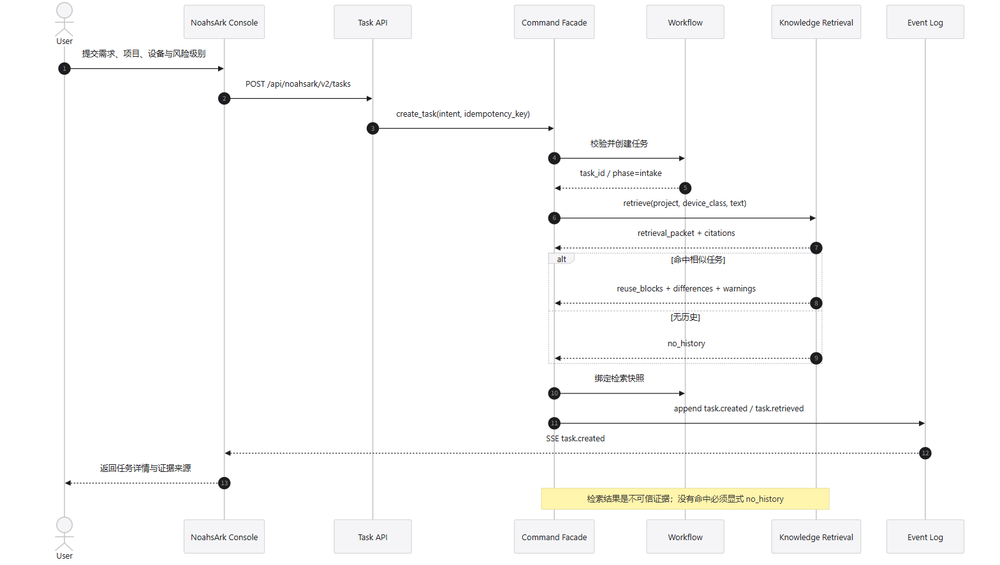

要点：M1 只负责创建任务，M5 返回检索包；无命中必须 `no_history`，检索结果不能覆盖平台硬约束。

### 6.2 方案评审与批准

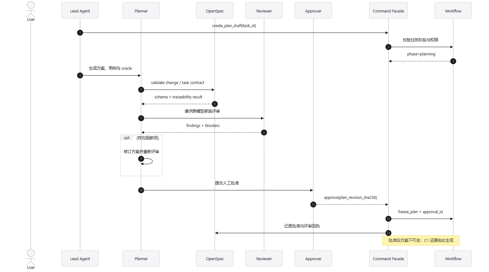

要点：M6 生成候选，M10 提供 OpenSpec/评审规则，M0 冻结方案并产生 C1 证据。

### 6.3 真实执行

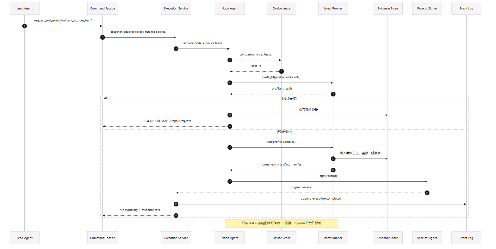

要点：M9 先确认兼容，M2 申请租约，预检失败进入人工；正式执行必须 `real`，回执由节点签名。

### 6.4 完成与归档

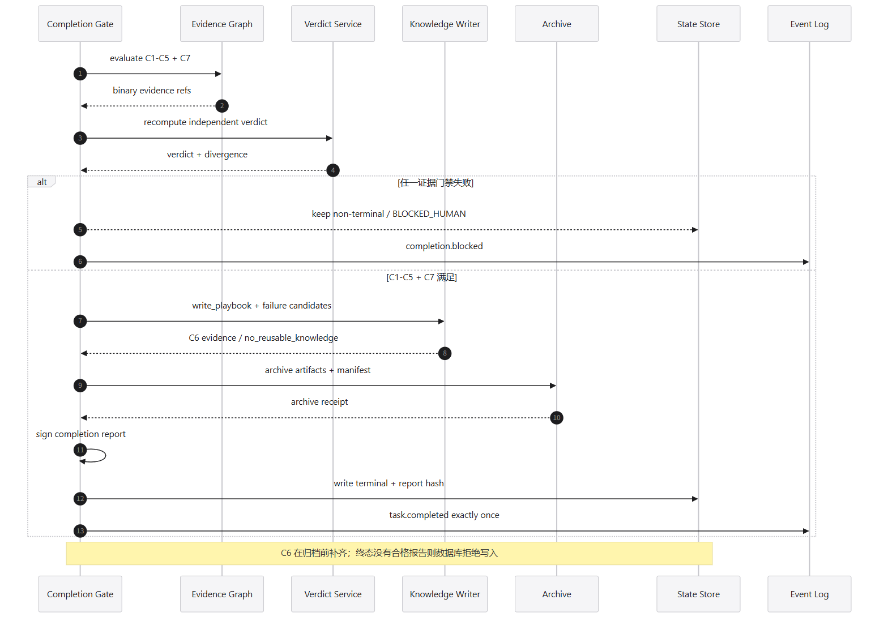

要点：M7 先算 C1–C5/C7，再要求 M5 补 C6，最后归档签核；任何缺失都不得写终态。

### 6.5 模型切换

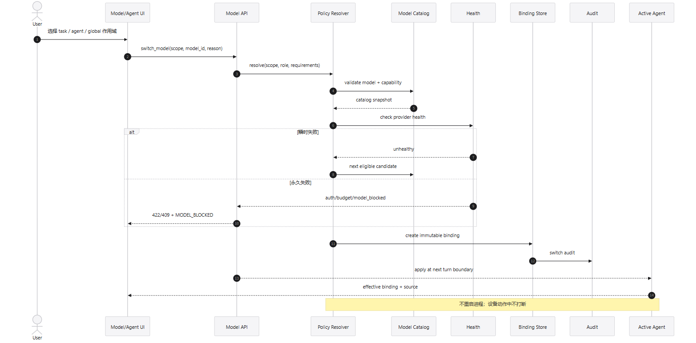

要点：M3 不重启进程；切换在下一回合边界；永久错误 `MODEL_BLOCKED`，不静默降级。

### 6.6 事件与推送

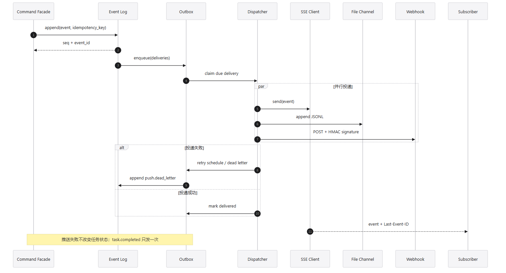

要点：先落库后投递；至少一次、消费端去重；推送失败不改变任务状态。

### 6.7 接管

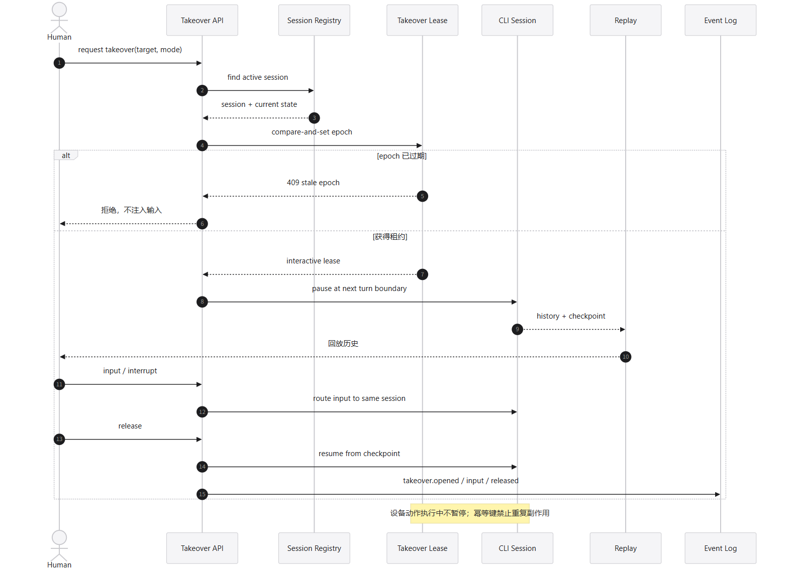

要点：M8 用 epoch CAS 独占交互；设备动作中不暂停；输入进入同一会话。

### 6.8 工具链

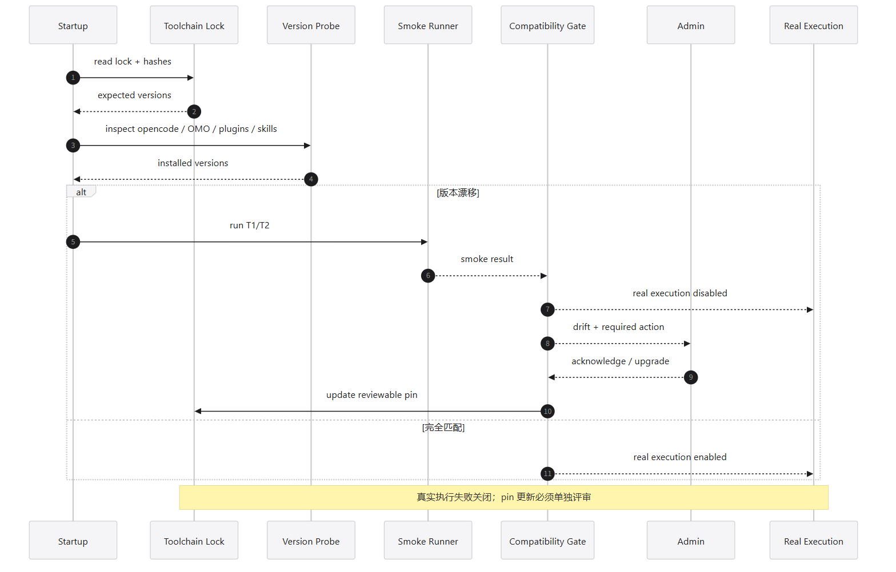

要点：M9 漂移时关闭真实执行；T1/T2 通过不等于 T3；pin 更新单独评审。

### 6.9 Agent 与 OpenSpec

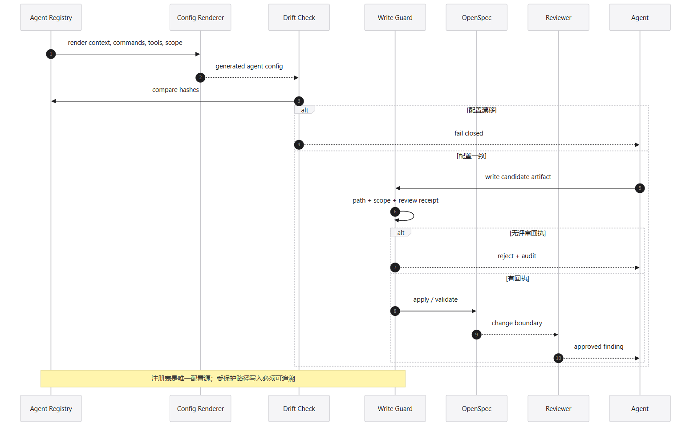

要点：注册表是唯一来源；生成配置漂移失败关闭；受保护写入需要评审回执。

### 6.10 UI 投影

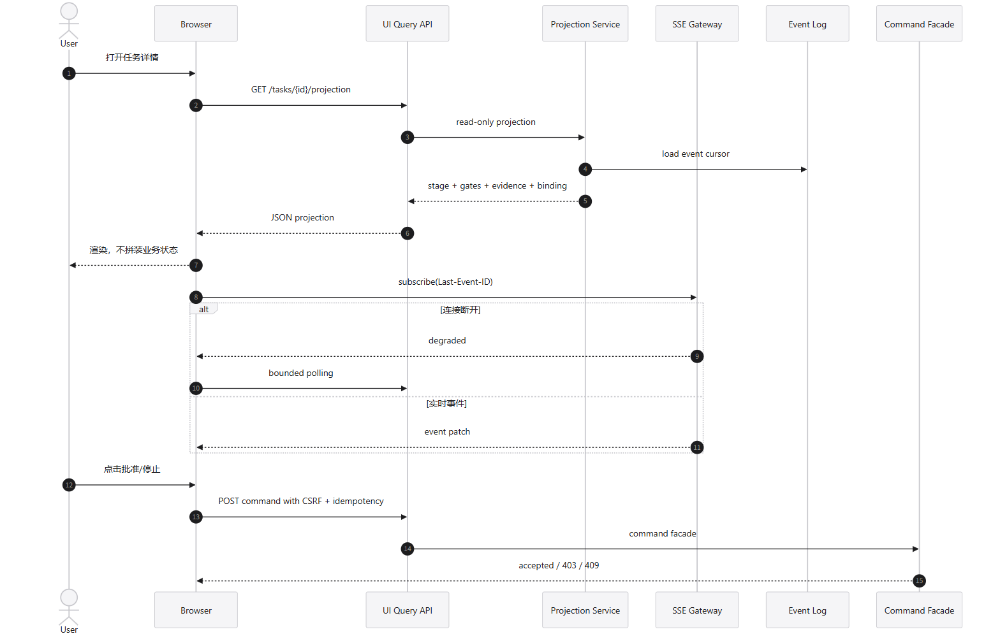

要点：M11 只读投影，不在浏览器拼业务状态；SSE 断线降级轮询。

### 6.11 讨论插件

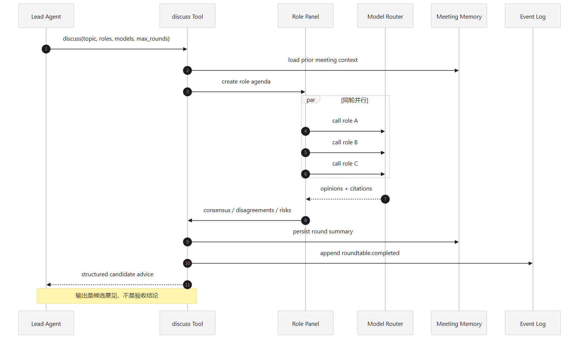

要点：讨论是候选意见，不是验收结论；多家族不足时标记 `PANEL_DEGRADED`。

### 6.12 知识检索

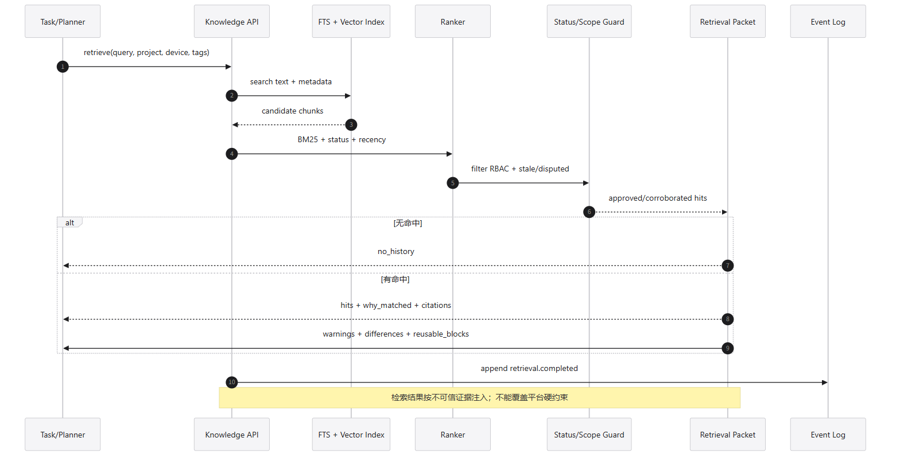

要点：M5 只返回带引用、边界、冲突和反例的证据；approved 不被 stale/disputed 静默压过。

### 6.13 失败与修复

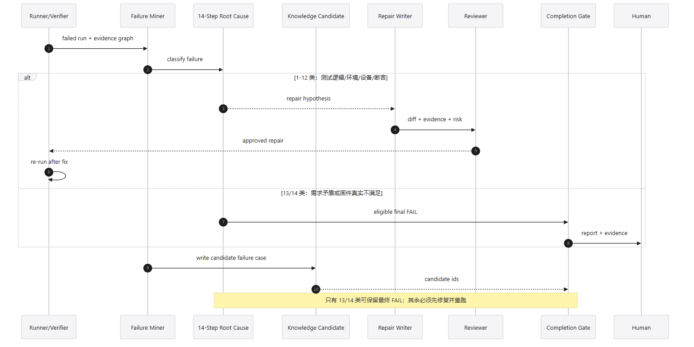

要点：1–12 类失败先修复并重跑；只有 13/14 类可保留最终 FAIL；修复候选必须经评审。

---

## 7. 模块实施顺序

| 波次 | 模块 | 退出条件 |
|---|---|---|
| W0 | M0 + M1 + M2 骨架 | 命令门面、任务状态、租约、回执契约可测试 |
| W1 | M3 + M4 | 模型绑定/切换与事件/推送可独立验收 |
| W2 | M5 | 检索包、引用、no_history、playbook 候选可验收 |
| W3 | M6 + M10 + M12 | 方案/用例/oracle、评审、Agent 配置、讨论工具 |
| W4 | M7 | C1–C7、独立重算、归档、终态守卫 |
| W5 | M8 | 接管租约、回放、输入、恢复 |
| W6 | M11 | 11 个主入口、15 页、SSE 降级 |
| W7 | M9 + M2 真实适配器 | 工具链锁、T1/T2/T3、真实设备 E2E |

### 7.1 当前设计缺口

1. **M2 执行适配器没有独立任务**：81 项计划中 P5-03/P8-03 假设它存在，但没有列出节点 Agent/lstest runner 适配器的实现任务。实施前必须补充。
2. **M6 方案/用例/oracle 的持久化表未冻结**：现有 schema 列表没有 `plan_revisions`/`case_sets`/`oracle_sets`，需要明确是表还是任务产物清单。
3. **M2/M7 证据目录格式未冻结**：C3/C5 需要 manifest、逐文件哈希和分母定义；需在 P0-04 增加证据目录契约。
4. **M9 的 T3 真实设备窗口**：没有真实设备时只能完成 T1/T2，不能声称升级完成。
5. **M5 的 PDF 摄取**：5 个美的 PDF 尚未进入正文索引；检索质量报告需标注该缺口。

> 每个缺口的关闭方式、需要的外部输入和新任务编号见 [`GAP-CLOSURE.md`](./GAP-CLOSURE.md)。建议将 81 项扩展为 86 项：P5-00、P0-03b、P0-04b、P8-03b、P3-07b。

---

## 8. 失败处理与安全

| 失败 | 所属模块 | 结果 |
|---|---|---|
| 契约校验失败 | M0 | 拒绝命令，不落库 |
| 非法阶段跳转 | M1 | 409，保留当前阶段 |
| 设备/租约冲突 | M2 | 409，进入 `BLOCKED_HUMAN` 或等待 |
| dry-run 作为完成证据 | M2/M7 | C2 false，不得 PASS |
| 模型能力不足 | M3 | 422，不修改旧绑定 |
| 永久 provider 错误 | M3 | `MODEL_BLOCKED`，转人工 |
| 推送失败 | M4 | 警告/死信，不改任务状态 |
| 无检索命中 | M5 | 显式 `no_history` |
| 陈旧/争议知识 | M5 | 显示警告，不可静默压过 approved |
| 方案未批准 | M6/M1 | 不得执行 |
| 证据/结论分歧 | M7 | 阻断 PASS，人工复核 |
| C6 未写回 | M7 | 不得归档 |
| 接管 epoch 过期 | M8 | 409，不注入输入 |
| 工具链漂移 | M9 | 真实执行失败关闭 |
| 配置漂移/越权写入 | M10 | 失败关闭并审计 |
| SSE 断线 | M11 | degraded + 有界轮询 |

安全基线：统一脱敏 authorization/cookie/token/key；provider secret 只留服务端 `credential_ref`；Webhook HTTPS + HMAC + SSRF allowlist；知识摄取 secret/PII 扫描；受保护路径写入门禁；接管审计；路径守卫。

---

## 9. 验收标准

每个模块完成后至少满足：

1. 单元/契约测试覆盖成功、非法输入、幂等重复和失败分支。
2. 模块边界测试证明没有直接跨模块写表。
3. 关键时序图对应的 happy path 和 failure path 都有可执行证据。
4. 事件可重放；重复事件不产生重复副作用。
5. 真实执行相关模块必须有真实设备回执；mock 不能作为完成证据。
6. UI 只消费 projection；命令经过门面；SSE 断线可降级。
7. 每个模块的验收证据记录在 `.omo/evidence/ai-test-platform-v2/`。

### 9.1 模块完成定义

- **M0**：命令/幂等/事务/事件/安全基线测试通过。
- **M1**：阶段机和终态守卫通过，非法跳转被拒。
- **M2**：租约、预检、正式运行、签名回执、证据 manifest 通过。
- **M3**：任务/Agent/全局切换、回退、审计、无重启通过。
- **M4**：事件重放、SSE/文件/Webhook、去重、死信通过。
- **M5**：检索引用、no_history、stale/disputed、playbook 写回通过。
- **M6**：方案/用例/oracle schema、追溯、评审、批准冻结通过。
- **M7**：C1–C7、独立重算、归档、数据库触发器通过。
- **M8**：epoch CAS、暂停/回放/输入/释放、幂等副作用通过。
- **M9**：锁校验、T1/T2、漂移阻断、T3 真实验收。
- **M10**：注册表渲染、漂移检查、写守卫、评审回执。
- **M11**：15 页投影、SSE 降级、权限与命令入口。
- **M12**：讨论结构化输出、引用、`PANEL_DEGRADED`。

---

## 10. 结论

这份设计把 13 个模块拆成可实施的命令、数据、事件和时序边界。真正进入实现前，先补齐第 7.1 节的 5 个缺口，尤其是 M2 执行适配器和 M6 方案持久化；否则 Phase 8 的“真实运行”仍会悬空。

本文只定义设计，不含产品代码；下一步是在 M0 批准后按 W0–W7 顺序执行 P0-02 起的任务。
