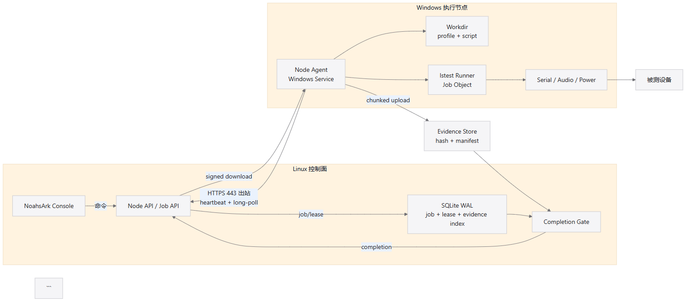
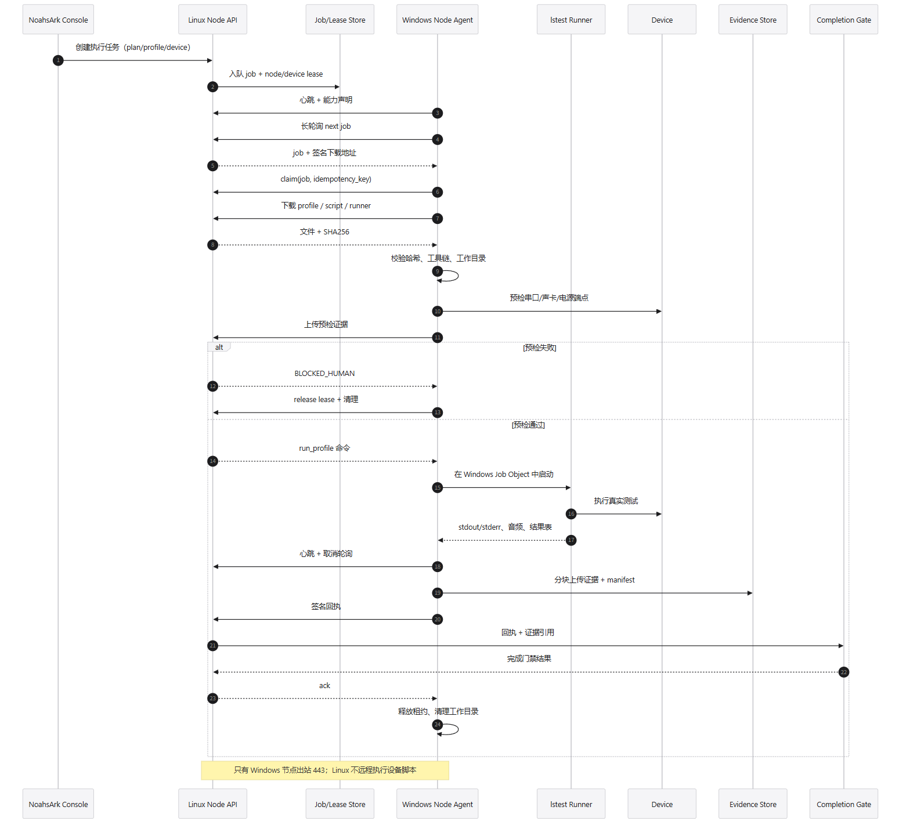

# NoahsArk 远程节点执行方案

> 状态：M0 设计评审版，未进入产品实现
> 适用：Linux 控制面 + Windows 执行节点 + 连接在 Windows 节点上的设备
> 目标：脚本/工具/执行器在 Windows 本地运行，Linux 只做编排、授权、证据验收和结果归档

---

## 0. 结论

采用 **Windows 节点主动出站 HTTPS + 长轮询任务**，不使用 Linux 主动 SSH/WinRM 登录 Windows，也不把设备命令放到 Linux 执行。

核心边界：

- **Linux 控制面**：任务、租约、模型、知识、门禁、事件、证据索引、UI。
- **Windows 节点**：节点 Agent、设备访问、脚本/工具、lstest runner、原始证据采集。
- **设备**：只连接 Windows 节点；串口、声卡、电源控制都在 Windows 本地。
- **传输**：Windows 节点只出站到 Linux 的 443；Linux 不向节点发起入站连接。
- **证据**：Windows 上传原始证据和 manifest；Linux 只校验、索引、归档，不重新执行设备动作。

这样设计的原因：

1. 现场 Windows 节点通常在防火墙/NAT 后面，开放 SSH/WinRM 入站不现实。
2. 串口、声卡、USB、电源控制都在 Windows，执行必须贴着设备。
3. Linux 不保存设备凭据，节点也不需要 provider secret。
4. 节点离线时任务可以排队；重连后幂等领取，不会重复执行。

---

## 1. 总体拓扑



> 源文件：[remote-execution-topology.mmd](./sequences/remote-execution-topology.mmd)

| 层 | 位置 | 职责 |
|---|---|---|
| 控制面 | Linux | Flask API、任务/租约、模型策略、知识、门禁、事件、证据索引、UI |
| 节点服务 | Windows | 注册、心跳、长轮询、下载工件、启动/停止 runner、上传证据 |
| 会话执行器 | Windows 登录会话 | 串口/声卡/USB/电源访问、lstest 执行、GUI/音频设备 |
| Runner | Windows | lstest/profile、脚本、工具、原始日志和结果 |
| 设备 | Windows 本地 | 被测设备、串口、音频端点、电源/继电器 |
| 证据存储 | Linux | 内容寻址文件、manifest、回执、归档 |

---

## 2. 技术栈

### 2.1 Linux 控制面

| 组件 | 选型 | 说明 |
|---|---|---|
| OS | Ubuntu 22.04/24.04 LTS | 内网单机部署 |
| 运行时 | Python 3.12 | 与 lstest/工具链一致 |
| Web | Flask 3 + Jinja2 | 现有 D2 决策；不引入 SPA 构建链 |
| WSGI | Gunicorn `gthread` | 长轮询会占用线程；设置足够 worker/thread 和 60s 超时 |
| 反向代理 | Nginx 或 Caddy | TLS 终止、WebSocket 预留、请求体限制；Caddy 更简单 |
| 数据 | SQLite WAL | job/lease/evidence index；单控制面；后续可换 PostgreSQL |
| 队列 | SQLite 表 + outbox | 不引入 Redis/RabbitMQ；job 状态和租约可审计 |
| 证据 | 本地内容寻址目录 | `evidence/<task>/<execution>/...`；后续可接 MinIO/S3 |
| 进程 | systemd | `noahsark.service` 自启、重启、日志 |
| 安全 | TLS、HMAC、Ed25519 验签、RBAC | 节点 token + 短时下载 token |

### 2.2 Windows 节点

| 组件 | 选型 | 说明 |
|---|---|---|
| OS | Windows 10/11 | 测试机；建议自动登录专用测试账户 |
| 运行时 | Python 3.12 | 与 lstest 一致；可用嵌入式 Python 或独立 venv |
| Agent | Python `httpx` | 长轮询、心跳、分块上传；只出站 443 |
| 服务包装 | WinSW（或 NSSM） | `NoahsArkNodeService` 自启、崩溃重启、日志 |
| 会话执行器 | 计划任务/登录启动 | 负责音频/串口/USB/GUI；避免 Session 0 无音频端点 |
| 设备串口 | `pyserial` + USB VID/PID/serial | 不能只用 COM 编号 |
| 音频 | `sounddevice`/PortAudio + MMDevice | 端点 ID、采样率、通道能力 |
| 进程控制 | Windows Job Object（`pywin32`） | 杀进程树、资源限制、异常退出回收 |
| 签名 | `cryptography` Ed25519 | 节点回执签名；服务端只存公钥 |
| 打包 | PyInstaller/venv + 签名 zip | 版本化安装、可回滚 |
| 监控 | `psutil` + 本地日志 | CPU/内存/子进程/磁盘 |

### 2.3 为什么不用 SSH/WinRM/远程 PowerShell

- Windows 节点通常无入站端口；开放 22/5985/5986 增加攻击面。
- 凭据会散落在 Linux；与“secret 不出服务端”冲突。
- 难以可靠流式采集音频、串口和 GUI 证据。
- 远程 shell 无法保证进程树、设备租约和幂等副作用。

### 2.4 为什么 v2 用长轮询而不是 WebSocket

- 长轮询只依赖 HTTPS 443，NAT/防火墙友好，Flask 可直接承载。
- 任务下发不是毫秒级需求；25 秒长轮询足够。
- 事件/日志由节点批量 POST，UI 仍用 SSE；不增加 WebSocket 代理和 ASGI 进程。
- 如果后续需要毫秒级控制，可在 v2.1 增加 WebSocket，保持同一消息契约。

---

## 3. 关键设计：Windows 服务 + 登录会话执行器

**这是远程执行最容易踩的坑。** Windows 服务默认运行在 Session 0，音频端点、部分 USB/GUI 设备在 Session 0 不可见。因此不能把整个 Agent 简单装成“LocalSystem 服务”就结束。

推荐双层：

```text
NoahsArkNodeService (Windows Service, LocalSystem)
  - 开机自启、健康检查、自动更新、拉起会话执行器
  - 不直接碰音频/GUI
  - 通过 named pipe 与 Session Agent 通信

NoahsArkSessionAgent (test user logon session)
  - 自动登录测试账户后由计划任务启动
  - 串口、声卡、USB、电源、lstest 执行
  - 只处理本机 job；退出由 Service 重启
```

如果项目只用串口、不需要音频/GUI，可只跑 Service；但只要涉及声卡/音频回环，必须使用登录会话执行器。

---

## 4. 协议与 API

### 4.1 节点注册

```http
POST /api/noahsark/v2/node/register
Authorization: Bearer <bootstrap-token>
{
  "node_id": "win009",
  "hostname": "win009",
  "os": "Windows 11 23H2",
  "agent_version": "1.0.0",
  "capabilities": ["serial", "audio", "power", "lstest"],
  "public_key": "ed25519:...",
  "labels": {"project": ["TCL", "美纳"], "location": "lab-a"}
}
```

服务端返回 `node_token`（可轮换）和 `server_time`。节点不保存用户密码/provider key。

### 4.2 心跳与能力

```http
POST /api/noahsark/v2/node/heartbeat
{
  "node_id": "win009",
  "agent_version": "1.0.0",
  "tools": {"lstest": "0.9.14", "python": "3.12.8", "opencode": "1.15.0"},
  "devices": [{"device_id":"tcl003","serial":"COM7","audio":"TCL003 Audio","state":"online"}],
  "running_job": "job-...",
  "load": {"cpu": 42, "mem": 61}
}
```

心跳 5 秒；连续 3 次缺失，服务端标记 `node_stale`，租约进入过期流程。

### 4.3 取任务（长轮询）

```http
GET /api/noahsark/v2/node/jobs/next?wait=25
Authorization: Bearer <node_token>
```

返回 `204 No Content` 或：

```json
{
  "job_id": "job-...",
  "task_id": "ait-...",
  "action": "preflight|run_profile|stop|diagnostics",
  "run_mode": "real",
  "plan_sha256": "...",
  "profile_sha256": "...",
  "script_sha256": "...",
  "device_id": "tcl003",
  "lease_id": "lease-...",
  "lease_epoch": 7,
  "downloads": [
    {"kind":"profile","url":"/node/artifacts/...","sha256":"..."},
    {"kind":"script","url":"/node/artifacts/...","sha256":"..."}
  ],
  "timeout_sec": 7200,
  "idempotency_key": "job:...:run"
}
```

节点只能执行 `action` 枚举，不能接受任意 shell 字符串。

### 4.4 认领、心跳、状态

```http
POST /node/jobs/{job_id}/claim
POST /node/jobs/{job_id}/state
POST /node/jobs/{job_id}/logs
POST /node/jobs/{job_id}/receipt
POST /node/jobs/{job_id}/release
```

`claim` 带 `idempotency_key` 和 `lease_epoch`；重复 claim 返回同一 job，不重复执行。

### 4.5 证据上传

```http
POST /node/jobs/{job_id}/evidence/init
POST /node/jobs/{job_id}/evidence/chunk
POST /node/jobs/{job_id}/evidence/complete
```

- 4 MB 分块；每块 SHA256。
- 服务端按 `evidence/<task>/<execution>/` 写入内容寻址文件。
- 上传完成校验 manifest；不完整则不进入 M7。

---

## 5. Job 状态机

```text
queued
  -> offered       (长轮询返回)
  -> claimed       (节点认领)
  -> preparing     (下载/校验/建工作目录)
  -> preflight     (设备/工具/端点预检)
  -> running       (正式执行)
  -> uploading     (证据+回执)
  -> verifying     (服务端校验)
  -> completed     (成功归档)

任一阶段 -> failed / blocked / stopped / lost
```

规则：

- `preflight` 失败 → `blocked`，不得进入 `running`。
- `running` 中节点失联 → `lost`；租约过期，不能直接重跑成 PASS。
- `uploading` 未完成 → 不得进 `verifying`。
- `verifying` 失败 → 回 `blocked`/`failed`，证据保留。
- 重复 job/claim/receipt 都幂等；`receipt.nonce` 一次性。

---

## 6. 执行逻辑：从 Linux 到 Windows 设备



> 源文件：[seq-14-remote-windows-node.mmd](./sequences/seq-14-remote-windows-node.mmd)

### 6.1 逐步说明

| 步骤 | 触发 | 输入 | 校验/决策 | 写入/状态 | 结果传导 | 失败出口 |
|---|---|---|---|---|---|---|
| R1 | 用户/父任务请求执行 | task、plan、binding、device | 方案冻结；M9 兼容；租约可用 | job `queued` | 长轮询可取 | 422/409 |
| R2 | 节点心跳 | node token、能力、设备 | 节点版本/工具链 | heartbeat | 节点状态 | 失效→stale |
| R3 | 节点长轮询 | node_id、wait | 节点匹配、租约、job 可用 | job `offered` | 返回 job + signed URL | 204/超时 |
| R4 | 节点 claim | job_id、lease_epoch、idempotency | 租约未过期；只允许一个 claim | job `claimed` | 节点开始准备 | 409 |
| R5 | 下载工件 | profile/script/runner | SHA256、大小、路径守卫 | local workdir | 校验通过 | 拒绝执行 |
| R6 | 预检 | 串口/声卡/电源/工具链 | 端点存在；profile 可编译；预检样本 | preflight evidence | 上传给 Linux | `blocked` |
| R7 | 正式 run | approved plan、real mode | 预检通过；设备未被占用 | job `running` | 本地 lstest 执行 | 不启动 |
| R8 | 采集/心跳 | stdout/stderr/日志/音频/结果表 | 非空；hash；设备仍在线 | local evidence | 批量上传 | 断线→lost/stopped |
| R9 | 证据完成 | manifest + chunks | hash/路径/分母 | evidence store | job `uploading`→`verifying` | 缺证据→blocked |
| R10 | 签名回执 | node id、lease、endpoint、manifest | Ed25519 验签；nonce 唯一 | receipt | M7 completion | 失败→infra_error |
| R11 | 服务端验收 | receipt/evidence/plan | C1–C7 | job `completed` | M1 终态/事件 | 失败→blocked/failed |
| R12 | 清理 | job/lease/workdir | 只清自己的 | job done | 释放租约 | 重复清理幂等 |

### 6.2 本地执行内容

Windows 节点执行的不是一个“黑盒 shell”，而是受控 action：

- `preflight`：检查 Python/lstest 版本、profile 编译、串口/音频端点、电源通道、磁盘、时钟、工具链锁。
- `run_profile`：启动 lstest profile；按用例执行；采集串口、音频、结果表、工具日志。
- `stop`：在安全边界停止 runner；进程树回收；保留已采集证据。
- `diagnostics`：只读诊断，不执行测试。

执行器禁止：

- 接收任意命令字符串或远程 shell。
- 从 UI 直接执行 `powershell -Command`（除受控诊断适配器）。
- 修改已 pin 的工具链。
- 访问工作目录外路径。
- 读取 provider secret。

---

## 7. 结果传导

```text
Windows 本地证据
  -> 分块上传
  -> Linux evidence store（hash + manifest）
  -> M7 Completion Gate
  -> C2/C3/C4/C5/C7
  -> 完成报告
  -> M1 终态
  -> M4 task.completed
  -> UI / push / archive
```

- 原始证据只在节点生成；Linux 只做校验和索引。
- 节点回执不包含密钥；签名用节点私钥，服务端存公钥。
- M7 不信任节点自报的 PASS；必须独立重算并检查证据图。
- 证据缺失、manifest 不匹配、回执重复都阻断完成。
- UI 只显示证据引用和摘要，不展示 secret/原始敏感数据。

---

## 8. 离线、断线、重试

| 场景 | 处理 |
|---|---|
| 节点启动时离线 | 注册失败重试；不接受 job |
| 长轮询超时 | 返回 204，继续轮询；不是失败 |
| 下载中断 | 断点续传；hash 校验后重试 |
| 执行中节点失联 | 服务端标 `lost`；租约过期；保留部分证据；不自动 PASS |
| 执行中网络恢复 | 节点重新注册/心跳；上报本地 job 状态；服务端决定 resume/stop |
| 重复 claim | 同一 job 返回同一 handle，不重复执行 |
| 重复 receipt | nonce 唯一；第二次拒绝 |
| 上传中断 | 分块重传；manifest 全量校验 |
| 服务器重启 | job/lease 从 SQLite 恢复；节点重连后重新领取 |
| 设备拔插 | 端点身份变化 → preflight/运行失败 → `blocked`，不静默换端点 |

---

## 9. 安全

- Windows 节点只出站 443；不开放 SSH/WinRM/RDP 给 Linux。
- TLS + 节点 token；token 可轮换；job 下载 URL 短时有效。
- 节点回执 Ed25519 签名；服务端只存公钥；nonce 防重放。
- 节点只执行 action 枚举；禁止任意命令。
- 工作目录路径守卫；禁止路径穿越。
- Windows 进程用 Job Object 隔离/回收；资源上限。
- 不在节点保存 provider secret；设备凭据只留服务端 credential ref。
- 节点安装包签名；自动更新回滚；版本进 toolchain lock。
- 所有 job/claim/stop/takeover 写审计。

---

## 10. 部署

### Linux

```text
/etc/noahsark/config.yaml
/var/lib/noahsark/noahsark.db
/var/lib/noahsark/evidence/
/var/log/noahsark/
systemd: noahsark.service
reverse proxy: Caddy/Nginx 443
```

### Windows

```text
C:\Program Files\NoahsArk\Node\
  node-agent.exe / python env
  config.json
  logs\
C:\ProgramData\NoahsArk\
  work\<job-id>\
  cache\
  tools\
```

安装步骤：

1. 安装 Python/lstest 固定版本，写入 toolchain 快照。
2. 安装 WinSW 服务，配置出站 server URL、node token。
3. 配置测试账户自动登录；计划任务启动 Session Agent。
4. 防火墙只允许出站 443；禁止入站。
5. 运行 `node-agent diagnostics` 注册并上报能力。
6. 服务端 `POST /node/register` 完成节点登记。

---

## 11. 验收

- Linux 不向 Windows 发起任何入站连接；节点只出站 443。
- 节点离线时 job 保持 queued；重连后只执行一次。
- 下载工件 hash 不匹配时拒绝执行。
- 预检失败进入 `BLOCKED_HUMAN`，不进入正式运行。
- 正式运行必须 `run_mode=real`；dry-run 不产生 C2。
- 串口/音频/电源端点使用稳定身份；拔插/换 COM 不静默通过。
- 节点断线、runner 崩溃、上传中断、重复回执全部可恢复/拒绝。
- 证据 manifest 可重算；M7 能据此判断 C2/C3/C5。
- 音频设备在登录会话可用；不以 Session 0 假通过。
- 升级/回滚后节点版本进入 toolchain lock。

---

## 12. 需要补充的内容

- 节点清单：Windows 版本、Python/lstest、串口/声卡/电源、是否自动登录。
- 设备清单：型号、固件、稳定端点、项目 profile。
- 网络：Linux 地址、TLS 证书、节点出站代理/防火墙。
- 服务账户：测试账户、自动登录策略、磁盘配额。
- T3 窗口：真实 PASS/FAIL/STOPPED 的时间。
- 是否接受 **长轮询**；如果要求毫秒级取消，再评估 WebSocket v2.1。

> 本方案与 `GAP-CLOSURE.md` 的 G1 `P5-00 Execution adapter and node agent` 对应；实现前需要先把该任务加入 86 项计划。
